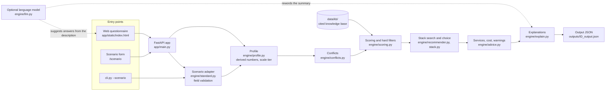
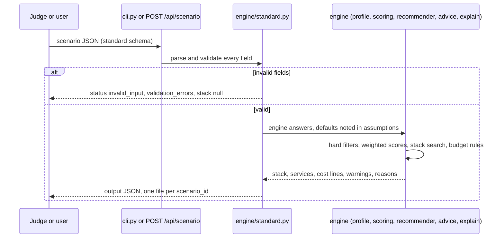

# StackSense

**Recommends a frontend, backend, database and hosting platform, plus the supporting services a project needs, from its scale, team, budget and compliance constraints. Deterministic rules over a cited knowledge base choose every component; a language model is optional and never picks one.**

[](https://www.python.org/downloads/)
[](https://fastapi.tiangolo.com/)
[](tests/)
[](#switch-off-the-language-model)
[](#validation-and-consistency)

Synergy '26 StackSense Challenge entry by Kanav Bhardwaj (IIIT Bangalore). Repository: <https://github.com/Paradox-73/StackSense26>

StackSense reads a project's parameters in the challenge's standard input schema, through a web questionnaire, a scenario form or the command line. It filters 70 technologies by the hard constraints (compliance, residency, deployment model, cloud), scores the rest on weighted criteria, searches whole stacks with 65 compatibility rules, and writes the standard output JSON. Each component lists the inputs that drove it, at least one alternative with the reason it lost, its trade-offs and a monthly cost band. Contradictions and broken constraints come back as warnings with a severity. The same input always gives the same stack.

## Contents

- [System architecture](#system-architecture)
- [Technology used, with versions](#technology-used-with-versions)
- [Prerequisites](#prerequisites)
- [Quick start: setup and run](#quick-start-setup-and-run)
- [Run a scenario file](#run-a-scenario-file)
- [Switch off the language model](#switch-off-the-language-model)
- [Validation and consistency](#validation-and-consistency)
- [Project structure](#project-structure)
- [Credits](#credits)
- [Run the checks](#run-the-checks)
- [Key results](#key-results)

## System architecture




| Module | Where | What it does |
|---|---|---|
| Web UI | `app/static/` | Plain HTML, CSS and JavaScript, no build step. `index.html` is the guided questionnaire; `scenario.html` (at `/scenario`) loads, edits and exports scenario files. |
| API | `app/main.py` | FastAPI routes: `POST /api/scenario` (standard schema in and out), `POST /api/recommend` for the questionnaire. Interactive docs at `/docs`. |
| Scenario adapter | `engine/standard.py` | Checks every field, maps the file to engine answers, records each default in `assumptions` and builds the output. It never calls a language model. |
| Engine | `engine/` | Pure Python, no dependencies: derive numbers, find conflicts, weight, filter, score, search stacks, estimate cost, explain. |
| Command line | `cli.py` | Runs scenario files and writes their output JSON; prints the built-in presets. |
| Language-model layer | `engine/llm.py`, `brief.py`, `summary.py` | Optional. Suggests questionnaire answers from a free-text description and rewords explanations. Every reply is checked, and each feature has a rule-based fallback. |
| Data | `data/` | Knowledge base, compatibility rules, questionnaire, glossary, presets, score rubric, explanation templates. |

Data flow for one scenario file:



## Technology used, with versions

| Part | Technology and version |
|---|---|
| Language | Python 3.12.10; CI also tests Python 3.10 and 3.13 on Windows, macOS and Linux |
| Web framework | FastAPI 0.142.2 on Starlette 1.7.0, Pydantic 2.13.5, Uvicorn 0.54.0 |
| Tests | pytest 9.1.1, HTTPX 0.28.1 |
| Frontend | HTML, CSS and JavaScript, no framework, no third-party script |
| Optional language model | Google Gemini API through its OpenAI-compatible endpoint (free tier), used only when a key is set |

`requirements.txt` gives the version ranges; `requirements.lock.txt` gives the exact versions the tests ran with.

## Prerequisites

- Python 3.10 to 3.13 (3.12 recommended), from <https://www.python.org/downloads/>. On Windows the installer's `py` launcher is enough.
- Windows 10/11, macOS or Linux. No database and no Node.js. Docker is optional.
- Internet on the first run only, to install the Python packages.
- No API key. Every feature works without one.

## Quick start: setup and run

1. Get the code: `git clone https://github.com/Paradox-73/StackSense26.git` and `cd StackSense26`, or open the submission's `source/` folder.
2. Start the app. The first run creates `.venv/`, installs `requirements.txt`, serves <http://127.0.0.1:8000> and opens the browser. Ctrl+C stops it.
   - Windows: `py run.py`
   - macOS / Linux: `python3 run.py`
   - Other port, no browser: `python run.py --port 8080 --no-browser`
3. Open **Scenario file** (<http://127.0.0.1:8000/scenario>) to load a scenario JSON, or answer the questionnaire on the home page.

Manual setup:

```bash
python3 -m venv .venv
.venv/bin/python -m pip install -r requirements.txt      # Windows: .venv\Scripts\python -m pip install -r requirements.txt
.venv/bin/python run.py                                  # Windows: .venv\Scripts\python run.py
```

Docker Compose (Docker Desktop, or Docker Engine with the Compose plugin):

```bash
docker compose up --build      # serves http://localhost:8000
docker compose run --rm stacksense python cli.py --scenario scenarios/public/P2.json
```

`STACKSENSE_PORT=8080` sets another host port. A `.env` file next to `compose.yaml` is passed into the container. Setup problems: [Troubleshooting](docs/REFERENCE.md#troubleshooting).

## Run a scenario file

Scenario files follow the standard input schema (statement section 3.2). The six public scenarios are in `scenarios/public/`, nine edge cases in `scenarios/edge/`.

```bash
python cli.py --scenario scenarios/public/P2.json                       # print the output JSON
python cli.py --scenario scenarios/public/P2.json --out my_output.json   # write it to a file
python cli.py --scenario scenarios/public --out outputs                 # every file in a folder
python cli.py --no-llm --scenario hidden/ --out results                 # hidden scenarios, model off
```

- With a folder, or an `--out` that is not a `.json` name, each output goes to `<out>/<scenario_id>_output.json`, for example `outputs/P2_output.json`. One line per scenario prints its status, the four picks and the file.
- A file may hold a JSON array of scenarios: each element gets its own output. `POST /api/scenario` takes one scenario or an array of up to 100.
- The command line needs no packages: any Python 3.10 or newer runs it.
- In the browser, **Scenario file** loads a file, shows the result and offers **Download output JSON**.
- `outputs/P1_output.json` to `P6_output.json` are the engine's output for the public scenarios.

## Switch off the language model

The model never chooses a component. To stop every model call (no request sent, no saved answer served):

- Environment variable: `STACKSENSE_LLM=off`, in the shell or in `.env` (see `.env.example`).
- Flag: `python run.py --no-llm`, `python cli.py --no-llm ...`.
- No API key also means no call. `GET /api/health` reports `llm_enabled` and `llm_switched_off`.

LLM-off test: `python -m pytest tests/test_llm_off.py` runs the public scenarios and every preset with a fake model on, then off, and fails if any stack differs. Scenario files never use the model.

## Validation and consistency

- **Validation.** Wrong types, negative or out-of-range numbers, unknown enum values and missing required fields give `"status": "invalid_input"`, one entry per field in `validation_errors`, and `"stack": null`. A file that is not JSON gets the same status with the parse error. Optional fields take documented defaults, each listed in `assumptions`.
- **Conflicts.** 22 cross-field checks among 68 warning codes report contradictions (one developer and microservices, HIPAA on a zero budget, 99.99% from a beginner) with a severity of info, warning or critical.
- **Hard constraints.** Compliance, data residency, deployment model and an explicit cloud remove options before scoring and are never relaxed. Budget, timeline and priorities are traded off and explained.
- **Consistency.** No randomness and no model in the choice: the same input gives byte-identical output. `tests/test_llm_off.py` fails if `outputs/` differs from the engine; the random-project test checks that renaming or reordering inputs changes nothing.

## Project structure

```
app/            web app: main.py (FastAPI routes), static/ (questionnaire, scenario page, styles, fonts)
engine/         standard.py (scenario format), profile.py, conflicts.py, scoring.py, recommender.py, stack.py,
                advice.py, explain.py, whatif.py; optional model layer: llm.py, brief.py, summary.py
data/           kb/ (technologies and compatibility rules), questions.json, presets.json, glossary.json,
                rubric.json, explain_templates.json, llm_cache/ (saved model answers)
scenarios/      public/ (P1-P6), edge/ (E1-E9)
outputs/        the engine's output JSON for P1-P6
tests/          pytest suite; benchmark/ holds the answer key for tools/bench.py
tools/          benchmark, fuzz test, question-influence study, screenshots, report and package builders
report/         report.md (source of the PDF), screenshots/, generated tables
docs/           architecture figures and REFERENCE.md (API, configuration, scoring detail, troubleshooting)
cli.py, run.py  command line and one-command launcher
```

The report PDF is `Report_Kanav_Bhardwaj.pdf`, next to `source/` in the submission folder; its source is [`report/report.md`](report/report.md). The output files are in [`outputs/`](outputs/).

## Credits

Libraries (open source):

- [FastAPI](https://fastapi.tiangolo.com/) (MIT), [Starlette](https://starlette.dev/) (BSD-3), [Pydantic](https://docs.pydantic.dev/) (MIT), [Uvicorn](https://uvicorn.dev/) (BSD-3): the web app
- [pytest](https://docs.pytest.org/) (MIT), [HTTPX](https://www.python-httpx.org/) (BSD-3): the tests
- Build tools, not needed to run the app: [markdown-it-py](https://github.com/executablebooks/markdown-it-py) (MIT), [pypdf](https://github.com/py-pdf/pypdf) (BSD-3), [Playwright for Python](https://playwright.dev/python/) (Apache-2.0) and Google Chrome, for the report PDF and screenshots
- Fonts in `app/static/fonts/`: [Atkinson Hyperlegible Next](https://github.com/googlefonts/atkinson-hyperlegible-next) and [Atkinson Hyperlegible Mono](https://github.com/googlefonts/atkinson-hyperlegible-next-mono) by the Braille Institute, via [Fontsource](https://fontsource.org/), SIL Open Font License 1.1 ([`OFL.txt`](app/static/fonts/OFL.txt))

APIs:

- [Google Gemini API](https://ai.google.dev/gemini-api/docs/openai) (optional, free tier) for the language-model features; [OpenRouter](https://openrouter.ai/) or another OpenAI-compatible API can be configured instead.

Datasets:

- None shipped. The [Stack Overflow Developer Survey 2025](https://survey.stackoverflow.co/2025/technology) is the hiring-pool proxy; INR budgets use the FBIL reference rate.

Sources:

- Every technology, rule and question cites official documentation, pricing or compliance pages. The register of 383 URLs is in [`report/sources.md`](report/sources.md).
- Methods: [expert systems](https://en.wikipedia.org/wiki/Expert_system), the [weighted sum model](https://en.wikipedia.org/wiki/Weighted_sum_model), counterfactual explanations (Wachter, Mittelstadt and Russell, [2017](https://arxiv.org/abs/1711.00399)), the quality attributes of [ISO/IEC 25010](https://www.iso.org/standard/78176.html) and the [AWS Well-Architected Framework](https://aws.amazon.com/architecture/well-architected/).
- References: Google SRE book ([availability table](https://sre.google/sre-book/availability-table/)), Martin Fowler ([MonolithFirst](https://martinfowler.com/bliki/MonolithFirst.html)), [Team Topologies](https://teamtopologies.com/key-concepts), [HHS HIPAA cloud guidance](https://www.hhs.gov/hipaa/for-professionals/special-topics/health-information-technology/cloud-computing/index.html), [PCI SSC document library](https://www.pcisecuritystandards.org/document_library/), [MeitY DPDP framework](https://www.meity.gov.in/data-protection-framework), [RBI storage of payment system data (2018)](https://www.rbi.org.in/Scripts/NotificationUser.aspx?Id=11244), [endoflife.date](https://endoflife.date/) and the [Microsoft lifecycle pages](https://learn.microsoft.com/lifecycle/).

## Run the checks

- Tests (a few minutes): `.venv/bin/python -m pytest` (Windows: `.venv\Scripts\python -m pytest`)
- Benchmark: `python tools/bench.py`; random-input test: `python tools/fuzz.py`
- Report PDF and screenshots (Google Chrome and `requirements-dev.txt`): `python tools/capture_screenshots.py`, then `python tools/build_report.py`
- Submission folder: `python tools/package_submission.py`

## Key results

- **Tests:** 1274 tests, including checks that every warning code is tested and that the numbers in this file match the code (`tests/test_docs.py`).
- **Benchmark** (`python tools/bench.py`): 40 project briefs against an answer key written before measurement. Result: 82% top-1 (129 of the 158 layer picks that have a best pick) and 96% acceptable (154 of all 160 layer picks); on the ten briefs held out from tuning, 72% and 95%. A language model playing three architect personas wrote the key, blind to the engine; no human architect checked it.
- **LLM-only comparison** (`python tools/llm_baseline.py --show`, offline, not part of the engine): LLM 84% top-1 on 158 picks, 94% acceptable on 160, against the engine's 82% and 96%, but the model breaks a hard requirement in 7 of the 40 briefs; the engine's picks break none.
- **Random projects** (`python tools/fuzz.py --n 1000 --growth-n 100`): 1,000 seeded random projects against 15 properties (hard constraints, identical repeats, renaming and reordering, no return to an earlier pick as users grow): 0 violations.
- **Questions:** 42 questions and 14 ready-made scenarios. The question-influence study (`python tools/question_influence.py`, 8,159 re-runs) varies 40 of them, and each changed a pick at least once; the project name and the currency only label the project and set the budget's unit.

More detail: [`docs/REFERENCE.md`](docs/REFERENCE.md).
