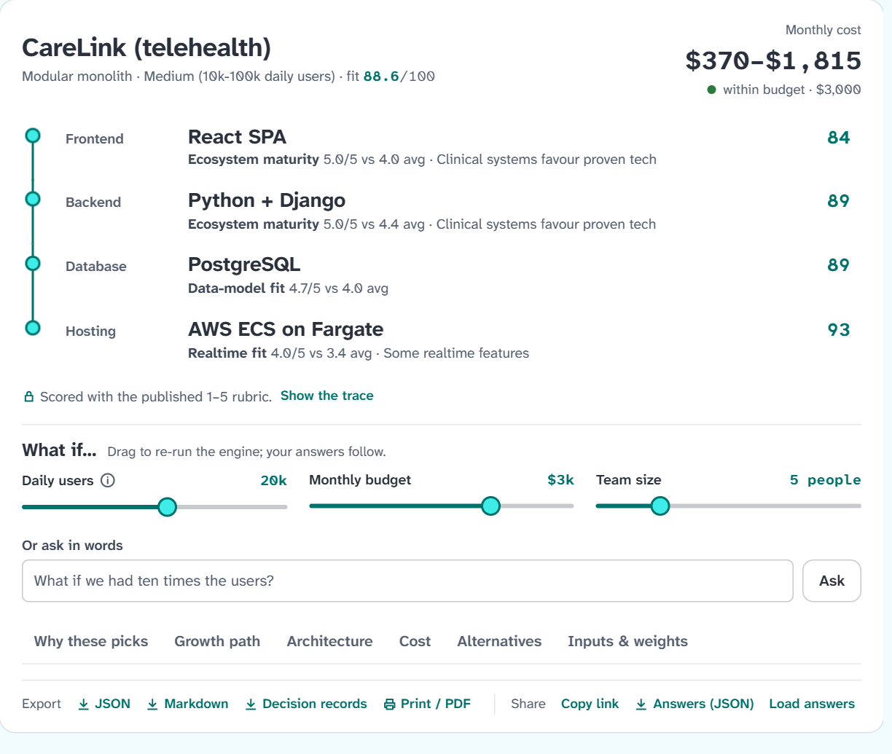
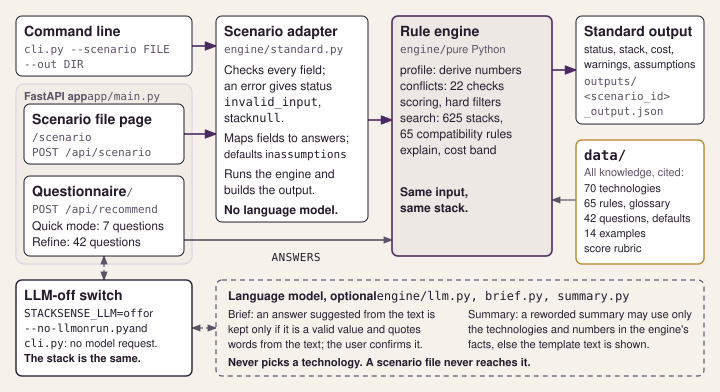
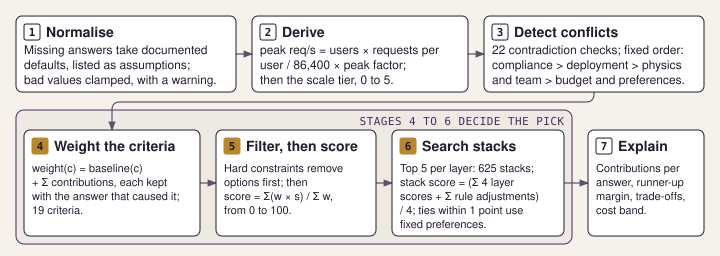

# StackSense: an explainable tech-stack recommendation engine

Author: Kanav Bhardwaj (IIIT Bangalore), Synergy '26 StackSense Challenge. Source: this folder (submitted as `StackSense_submission.zip`)

- StackSense asks up to 42 questions about a software project (scale, data, team, budget, compliance) and recommends a **frontend, backend, database and hosting** platform.
- Each pick comes with a 0-100 score, the answers that drove it, trade-offs, two alternatives, the options ruled out and why, a monthly cost estimate, and a "what would change this" analysis.
- 14 ready-made scenarios (presets) cover typical projects, from a college fest site to HIPAA telehealth.
- It is **rule-based and deterministic**: the same answers always give the same output, and every number traces to a JSON file in `data/`.
- An optional language model reads a free-text project description and words a summary. Code checks every model output, and the app works with no API key.



More screenshots are in `report/screenshots/` and `report/screenshots/gallery/`.



## Quick start

Needs Python 3.9 or newer (3.12 recommended). The first run needs internet to install dependencies; after that the app works offline.

- Windows (PowerShell or Command Prompt): `py run.py`
- macOS / Linux: `python3 run.py`
- The first run creates `.venv/`, installs `requirements.txt`, starts <http://127.0.0.1:8000> and opens the browser. Ctrl+C stops it.
- Other port, no browser: `python run.py --port 8080 --no-browser`

Manual setup:

```bash
python3 -m venv .venv
.venv/bin/python -m pip install -r requirements.txt      # Windows: .venv\Scripts\python -m pip install -r requirements.txt
.venv/bin/python run.py                                  # Windows: .venv\Scripts\python run.py
```

- No server wanted: `python cli.py --list`, `python cli.py --preset startup_mvp`, `python cli.py --all`
- `requirements.lock.txt` pins the exact versions the tests last ran with.
- Setup problems: see Troubleshooting in [`docs/REFERENCE.md`](docs/REFERENCE.md#troubleshooting).

## Run the checks

- Tests (917 tests, a few minutes): `.venv/bin/python -m pytest` (Windows: `.venv\Scripts\python -m pytest`)
- Benchmark against the answer key: `python tools/bench.py` (add `--briefs` for one line per brief)
- Random-input fuzz test: `python tools/fuzz.py` (exits 1 on any violation)
- Report build and screenshots (needs Chrome and `requirements-dev.txt`): `python tools/build_report.py`

## Architecture



| Part | Where | What it does |
|---|---|---|
| Browser | `app/static/` | One page of plain HTML, CSS and JavaScript; no build step, no third-party script. The form is built from `data/questions.json`. |
| API | `app/main.py` | FastAPI routes (FastAPI is a Python web framework): recommend, "Not sure" analysis, next question, why a pick changed, why not X, export. |
| Engine | `engine/` | Pure Python, no dependencies: clean inputs, derive numbers, find conflicts, weight, filter, score, search stacks, explain. |
| Language-model layer | `engine/llm.py`, `brief.py`, `summary.py`, `whatif.py`, `second_opinion.py` | Optional. Reads text and words summaries; each output is checked, and each feature has a rule-based fallback. |
| Data | `data/` | Technologies, compatibility rules, sources, questionnaire, glossary, presets, score rubric. |

## How it decides

- **Knowledge base:** 60 technologies (11 frontends, 14 backends, 15 databases, 20 hosting platforms) and 62 compatibility rules, curated on 2026-10-01 from official documentation. Each technology has 1-5 scores for 19 criteria.
- **Weights:** each criterion's weight starts at a baseline and is raised or lowered by specific answers (for example, "SEO critical" adds +4 to the SEO weight). Each change is stored with the answer that caused it.
- **Hard constraints first:** an option that breaks a requirement (HIPAA agreement, data residency, deployment model, scale ceiling and others) is removed before scoring. Compliance is never relaxed.
- **Score:** weighted average of the criterion scores, rescaled to 0-100, plus small adjustments with stated reasons (near the scale limit, over the budget share).
- **Stack search:** the top 5 options per layer give 625 combinations, scored with the compatibility rules (Next.js + Vercel is a plus, WebSockets on Netlify is a conflict). Stacks within 1 point count as tied and are settled by fewer unmet requirements, then your preferences.
- **Explanation:** each weight is a sum of per-answer contributions, so each score splits exactly into "which of your answers drove this". Counterfactuals re-run the engine with one answer changed. "Not sure" answers are re-run across plausible values to show which picks are safe.
- Full detail: [`docs/REFERENCE.md`](docs/REFERENCE.md#how-scoring-works).

## Where the LLM is used

**The rules decide. The language model never makes the recommendation.** It is used in four places at the edges, each with a rule-based fallback:

| Where | What the model does | What the code checks |
|---|---|---|
| Describe your project (`engine/brief.py`) | Reads a paragraph into questionnaire answers | Each value must be allowed by the questionnaire and come with a quote found in your text |
| Plain-English summary (`engine/summary.py`) | Rewords the engine's own facts | Every technology name and number must appear in the facts; otherwise a template summary is shown |
| Second opinion (`engine/second_opinion.py`) | Picks its own stack for your answers | The engine grades it; it is shown beside the engine's stack and never used as the pick |
| What if, in words (`engine/whatif.py`) | Maps "what if we had 10x users?" to answer changes | Same checks as the description reader; the engine then re-runs |

- **Reproducible:** model answers are cached as JSON in `data/llm_cache/`, and the model runs at temperature 0 (no randomness).
- **Testable:** tests use a fake network transport and never call a real model.
- **Optional:** set `STACKSENSE_LLM_API_KEY` to turn it on. Settings: [`docs/REFERENCE.md`](docs/REFERENCE.md#language-model-configuration).

## Key results

- **Benchmark** (`python tools/bench.py`): 40 project briefs scored against an answer key written before measurement. Result: 81% top-1 (128 of the 158 layer picks that have a best pick; 2 layer picks, both in brief A05, have no majority best pick) and 96% acceptable (154 of all 160 layer picks); held-out 72% and 95% (60% and 80% before the rule fixes in `tests/benchmark/baseline_before_fixes.json`). Ten briefs were held out and not used for tuning.
- **Who wrote the key:** a language model playing three architect personas, blind to the engine. They are not human raters, and the Krippendorff alpha of 0.91 (an agreement score; 1 is perfect) describes agreement between those personas only. The key's SHA-256 is in `tests/benchmark/answer_key.sha256`.
- **Fuzz test** (`python tools/fuzz.py`): 10,000 seeded random projects against 14 must-hold rules (hard constraints, same output on repeat, rename and reorder invariance, no flip-back as users grow). 0 violations. In 1,000 growth walks, 0 have a layer that returns to an earlier pick, down from 296 before the stability rules.
- **LLM-only comparison** (`python tools/llm_baseline.py --show`): the same 40 briefs answered by a language model alone with no rule engine, then graded by the rule engine. Method and numbers are in section 6.2 of `report/report.md`. The model alone scores about the same as the engine against the key (LLM 84% top-1 on 158 picks, 94% acceptable on 160, against the engine's 81% and 96%) but breaks a hard requirement in 7 of the 40 briefs; the engine's own picks break none.
- **Tests:** 917 tests, including a check that the numbers in this file match the code (`tests/test_docs.py`).

## Limitations

- Scores, cost bands and compliance flags are curated estimates from public documentation as of October 2026. Verify prices and compliance with each vendor before committing.
- The cost model uses price bands per scale tier, not an itemised bill. Egress, support plans and third-party SaaS are excluded.
- The knowledge base has 60 technologies. Niche options (CockroachDB, Oracle, Rust-specific frameworks and others) are not included.
- The answer key was written by a language model, not human architects.
- Without an API key, the pattern reader understands numbers, money and common phrases but not arbitrary prose, so some answers stay unfilled and the questions still ask for them.

## Credits and citations

**Libraries (all open source):**

- [FastAPI](https://fastapi.tiangolo.com/) (MIT)
- [Starlette](https://starlette.dev/) (BSD-3)
- [Pydantic](https://docs.pydantic.dev/) (MIT), a FastAPI dependency
- [Uvicorn](https://uvicorn.dev/) (BSD-3)
- [pytest](https://docs.pytest.org/) (MIT)
- [HTTPX](https://www.python-httpx.org/) (BSD-3), used by the test client
- [Google Gemini API](https://ai.google.dev/gemini-api/docs/openai) (hosted service, optional, free tier): the default OpenAI-compatible chat API for the language-model features; [OpenRouter](https://openrouter.ai/) or any other compatible API can be configured instead. It is called only when a key is set and is not a dependency of the engine.

The frontend uses no third-party JavaScript.

**Used only to test and to build the report (not needed to run the app):**

- [markdown-it-py](https://github.com/executablebooks/markdown-it-py) (MIT), [pypdf](https://github.com/py-pdf/pypdf) (BSD-3) and [Playwright for Python](https://playwright.dev/python/) (Apache-2.0), listed in `requirements-dev.txt`
- Google Chrome, which prints the PDF and takes the screenshots

**Fonts (bundled in `app/static/fonts/`, so the page loads with no internet):**

- [Fraunces](https://github.com/undercasetype/Fraunces), SIL Open Font License 1.1
- [Geist and Geist Mono](https://github.com/vercel/geist-font), SIL Open Font License 1.1

The licence text is in [`app/static/fonts/OFL.txt`](app/static/fonts/OFL.txt). `tests/test_no_network.py` checks that the page references no external resources and that the API answers with outbound connections blocked.

**Techniques and frameworks the design follows:**

- Expert system (knowledge base, inference, explanation): [Wikipedia](https://en.wikipedia.org/wiki/Expert_system)
- Weighted sum model for multi-criteria scoring: [Wikipedia](https://en.wikipedia.org/wiki/Weighted_sum_model)
- Counterfactual explanations: Wachter, Mittelstadt and Russell, [Counterfactual Explanations without Opening the Black Box](https://arxiv.org/abs/1711.00399) (2017)
- Quality attributes used to choose the questions: [ISO/IEC 25010](https://www.iso.org/standard/78176.html), [AWS Well-Architected Framework](https://aws.amazon.com/architecture/well-architected/), [ATAM](https://www.sei.cmu.edu/library/architecture-tradeoff-analysis-method-collection/)

**Datasets:** none is shipped. The Stack Overflow Developer Survey 2024 is cited as a proxy for hiring pools, and the exchange rate is the FBIL reference rate of September 2026.

**Data sources:**

- Every technology, rule and question cites official documentation. The full register of 344 URLs is in [`report/sources.md`](report/sources.md).
- Key methodological references:
  - Google SRE book: [availability table](https://sre.google/sre-book/availability-table/), [handling overload](https://sre.google/sre-book/handling-overload/)
  - Martin Fowler: [MonolithFirst](https://martinfowler.com/bliki/MonolithFirst.html), [Microservice trade-offs](https://martinfowler.com/articles/microservice-trade-offs.html)
  - [Team Topologies](https://teamtopologies.com/key-concepts)
  - Nielsen Norman Group: [response-time limits](https://www.nngroup.com/articles/response-times-3-important-limits/)
  - [Google Search JavaScript SEO basics](https://developers.google.com/search/docs/crawling-indexing/javascript/javascript-seo-basics)
  - [Jepsen consistency models](https://jepsen.io/consistency)
  - [HHS HIPAA cloud guidance](https://www.hhs.gov/hipaa/for-professionals/special-topics/health-information-technology/cloud-computing/index.html)
  - [PCI SSC document library](https://www.pcisecuritystandards.org/document_library/)
  - [MeitY DPDP framework](https://www.meity.gov.in/data-protection-framework)
  - [RBI storage of payment system data (2018)](https://www.rbi.org.in/Scripts/NotificationUser.aspx?Id=11244)
  - [Stack Overflow Developer Survey 2024](https://survey.stackoverflow.co/2024/technology), used as a proxy for hiring pools
  - [DORA research](https://dora.dev/research/)

More: [`docs/REFERENCE.md`](docs/REFERENCE.md) (API table, configuration, project layout, troubleshooting, full scoring description) and `report/report.md` (full report).
