# StackSense

<!-- The cover page (title, author, links) is generated from report/cover.json by tools/build_report.py. -->

## 1. Abstract

StackSense recommends a frontend, backend, database and hosting platform for a software project, plus supporting services such as a job queue, search, SMS sign-in or payments where needed. It reads a scenario file in the standard schema, validates every field and writes the section 4 output: a status, an architecture style, each component with its justification, driving input fields, alternatives and trade-offs, a monthly cost band, warnings with a severity and every assumption. Rules and weighted scoring over a cited knowledge base of 70 technologies make every choice, so the same file always gives the same stack. Data residency, compliance, deployment model and an explicit cloud remove options before any scoring. A language model is optional, never picks a component, and switching it off leaves every stack unchanged. A property test over 1,000 random projects found no violation of the eight hard constraints it checks.

## 2. Problem understanding

The statement judges a stack on its fit to the constraints, on the inputs the engine asks for and on how well it explains itself. I read that as three requirements: read the standard scenario file exactly and give a clear result for any file; decide with rules a reviewer can re-run, never with a language model; and quote the scenario's own fields and numbers in every explanation. Popularity lists ([StackShare](https://stackshare.io/), [DB-Engines](https://db-engines.com/en/ranking)) and practitioner ratings ([Thoughtworks Technology Radar](https://www.thoughtworks.com/radar)) ignore project constraints, so I use them as research, not as the method.

### 2.1 Scope decisions and assumptions

- **Two ways in, one engine.** Scenario files run through `cli.py`, the Scenario file page or `POST /api/scenario`; a guided questionnaire of 42 questions serves people starting from a blank page.
- **Sizing.** The stack is sized for `scale.users_12_months`, with daily users at 20% of it; `scale.users_at_launch` is the starting point. Both readings appear in `assumptions`.
- **Constraints.** Residency, compliance, deployment model and an explicit cloud are hard and remove options before scoring; `cloud_preference` `any` sets no constraint, and `none` rules out AWS, Google Cloud and Azure. Budget, timeline and priorities are soft and traded off with a stated reason.
- **"None" is a valid choice** for a layer that is not needed, with the reason, as for P1's backend and database.
- **The description is not parsed from a scenario file,** so wording cannot move the stack; in the app it only suggests fields that the user confirms.
- **Infeasible or relaxed.** If no stack meets the hard constraints, the status is `infeasible` with critical warnings; if soft goals conflict, it is `ok_with_warnings` and `assumptions` names each relaxed goal.
- **Cost** is an order-of-magnitude band with the basis of every line. Carbon footprint, interface design and start-up credits are out of scope (Appendix E).

## 3. System architecture

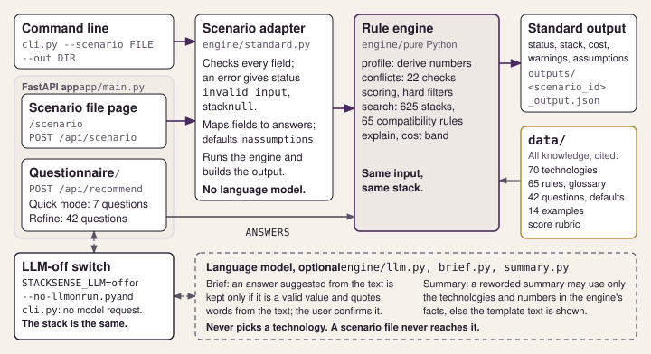

The engine (`engine/`) is pure Python. A FastAPI app (`app/main.py`) serves a JSON API, the guided questionnaire and the Scenario file page (`/scenario`), which loads a scenario JSON or a public example, shows every standard field as a form, runs it and downloads the output JSON. Scenario files reach the engine only through the adapter `engine/standard.py`. Knowledge lives in JSON files under `data/` with their sources; the optional language-model layer (`engine/llm.py`, `brief.py`, `summary.py`) sits outside the decision path, and `STACKSENSE_LLM=off` switches it off (Section 5.5).

### 3.1 Data flow from input to output

1. `cli.py --scenario FILE_OR_FOLDER --out FILE_OR_FOLDER`, `POST /api/scenario` or the Scenario file page reads the JSON. Text that is not JSON gives `invalid_input`.
2. `engine/standard.py` checks every field of table 3.1. Any error gives `invalid_input`, every error in `validation_errors` and `stack` null.
3. It maps the fields to engine answers and records every default and interpretation for `assumptions`.
4. `engine/profile.py` derives daily users, peak requests per second, the data size and the scale tier.
5. `engine/conflicts.py` runs 22 contradiction checks, each with its resolution.
6. `engine/scoring.py` weights 19 criteria and removes every option that breaks a hard constraint.
7. `engine/recommender.py` and `engine/stack.py` score the rest and search 625 stacks under 65 compatibility rules.
8. `engine/advice.py` adds the style, supporting services and cost band; `engine/explain.py` writes justifications, alternatives and trade-offs.
9. `engine/standard.py` assembles the section 4 output, and `cli.py` writes `outputs/<scenario_id>_output.json`.

The questionnaire posts its answers to `POST /api/recommend` and joins at step 4.

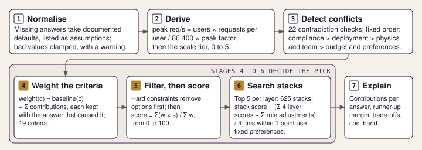

### 3.2 Technology used to build the engine

| Part | Technology and version |
|---|---|
| Language | Python 3.12.10; CI also runs the tests on Python 3.10 and 3.13 |
| Web app | FastAPI 0.142.2 on Starlette 1.7.0 with Pydantic 2.13.5, served by Uvicorn 0.54.0 |
| Browser pages | HTML, CSS and JavaScript; no framework, build step or third-party script |
| Tests | pytest 9.1.1 and HTTPX 0.28.1 |
| Optional language model | Google Gemini API through its OpenAI-compatible endpoint, only when an API key is set |
| Report and screenshots only | markdown-it-py, pypdf, Playwright for Python and Google Chrome |

`requirements.lock.txt` pins the versions. The six public scenarios run in about half a second in total from the command line.

## 4. Input design and research

### 4.1 How I chose the inputs

I started from the quality attributes of ISO/IEC 25010, the AWS Well-Architected Framework and ATAM and listed the project facts a recommender needs to score each (Appendix E), then added what only a technology choice needs: team skills, existing systems, data shape, client platforms and compliance regimes. An input stays only if it changes a decision. A study re-runs the engine with each other value of one question (Section 4.5), and `tests/test_questions.py` fails if a question never changes a pick, a cost or a warning. Every question has a default, a "Help me choose" hint and a note on why it is asked, most with a source, and all but the project name and the currency offer "Not sure".

### 4.2 The standard fields

Every field of table 3.1 is accepted under its exact name; Section 4.4 gives the checks.

| Fields | What they map to and which decisions they affect |
|---|---|
| `project`: type, platforms, name, description | The type sets an archetype, which fixes the default data shape, consistency, requests per user and some weights (marketplace scores like e-commerce, gaming like realtime collaboration). Platforms filter the frontend. Phones only rules out web frameworks, web plus phones adds a mobile companion, desktop an Electron shell and api_only "No frontend". The name labels the output; the description is not parsed. |
| `scale`: users_at_launch, users_12_months, peak_concurrent_users, data_volume_gb_12_months, traffic_pattern, workload | Daily users set the scale tier, peak requests per second, price bands and scale ceilings; concurrent users count open connections; data volume sets the database tier and storage cost; the pattern sets the peak factor; read-heavy work lowers the database tier and, with no sign-in, allows a static site. |
| `team`: size, experience, languages, has_devops | Operations-burden, structure and learning-curve weights; the minimum team per option; how many extra systems the team can run; skill match; on-call and self-hosting warnings. |
| `budget.monthly_infra_usd`, `timeline.mvp_weeks` | Cost weight and the minimum-bill check; development-speed, learning-curve and skill weights. |
| `infrastructure`: cloud_preference, deployment_model, data_residency, existing_systems | Hard filters (Section 5.3); existing systems add a database bonus, identity reuse, API integration and end-of-life warnings. |
| `requirements`: realtime, offline_support, full_text_search, file_media_storage, payments, multi_tenant, seo_critical | WebSocket-capable hosts; offline sync; search; storage, CDN and jobs; hosted checkout; tenant isolation in the database; the SEO weight. |
| `requirements`: auth, ml_features, availability, p95_latency_ms | Sign-in rules out static-only options, phone_otp adds SMS and enterprise_sso an identity broker; model serving, vector data or GPUs; SLA and single-node filters and redundancy cost; the performance weight. |
| `compliance`, `priorities` | Hard filters (Section 5.3); priorities rated 4 or 5 raise their criteria's weights, for at most three keys. |

### 4.3 Extra inputs and the research behind them

The questionnaire asks 42 questions in five groups. Most are the standard fields in plain words; the inputs below have no standard field. A scenario file never needs them, because each takes a documented default or a value derived from the standard fields, listed in `assumptions`. The last column is the share of re-runs in which changing the input changed a pick (Section 4.5).

| Extra input | Why it changes the architecture | Research | Pick changed |
|---|---|---|---|
| Kind of data (data shape) | Data-model fit is the largest database criterion | [MongoDB](https://www.mongodb.com/resources/basics/databases/nosql-explained), [Neo4j](https://neo4j.com/docs/getting-started/graph-database/) | 65% |
| Vendor lock-in tolerance | Proprietary APIs make leaving a vendor a rewrite | [Fowler on lock-in](https://martinfowler.com/articles/oss-lockin.html) | 30% |
| Background work | Functions stop at a time limit (Lambda: 15 minutes) and rent no GPUs | [AWS Lambda limits](https://docs.aws.amazon.com/lambda/latest/dg/gettingstarted-limits.html) | 17% |
| Peak requests per second | Peak load, not the average, sizes compute | [Little's law](https://en.wikipedia.org/wiki/Little%27s_law), [Google SRE](https://sre.google/sre-book/addressing-cascading-failures/) | 17% |
| Tenancy (one, shared, database per customer) | A shared database needs a filter the database enforces | [PostgreSQL row security](https://www.postgresql.org/docs/current/ddl-rowsecurity.html), [AWS SaaS Lens](https://docs.aws.amazon.com/wellarchitected/latest/saas-lens/silo-pool-and-bridge-models.html) | 11% |
| What users do (read, sign in, post, pay) | Read-only visitors need no server code or database | [Astro content collections](https://docs.astro.build/en/guides/content-collections/) | 9% |
| Consistency | Ledgers rule out eventually consistent stores | [Jepsen](https://jepsen.io/consistency) | 5% |

Architecture preference (7%, [MonolithFirst](https://martinfowler.com/bliki/MonolithFirst.html)), special workloads (5%), the cacheable share (2%) and user regions (1%) complete the list; special workloads change only the cost or warnings in 47% of re-runs. Appendix B lists all 42 questions.

### 4.4 Validation rules

- **Types, values and ranges.** Every field has its table 3.1 type, and enum values are lower-case strings exactly as written, so `availability: 99.9` as a number is an error that names the allowed strings. Counts are 0 or more, team size and weeks 1 or more, latency above 0 or null, priorities 1 to 5, numbers finite, the description any length and the platform list non-empty.
- **Required fields.** `project.type`, `project.platforms`, `scale.users_at_launch`, `scale.users_12_months`, `team.size`, `team.experience`, `team.languages` (may be empty), `budget.monthly_infra_usd` and `timeline.mvp_weeks`. In an otherwise valid file a missing one takes its documented default with a `MISSING_REQUIRED_FIELD` warning; a missing optional field takes its default, noted in `assumptions`.
- **Unknown keys.** An unknown enum value or priority key is an error; any other unknown key raises an `UNKNOWN_FIELD` info warning and is ignored.
- **Result.** Any error gives `invalid_input`, `stack` null and every problem in `validation_errors`; nothing raises. The questionnaire clamps a bad value with a warning instead (`VALUE_CLAMPED`).

### 4.5 What the measurements show

`tools/question_influence.py` re-ran the engine 8,159 times on the 14 presets and 40 seeded random projects, setting one question at a time to each of its other values. Team skills changed a pick in 90% of re-runs (an upper bound, as skills vary as whole sets), the data shape in 65%, air-gapped deployment in 63%, the deployment model in 51% and client platforms in 49%. The traffic pattern, cacheable share, company sign-in, machine-learning features and user regions change a pick in 2% or fewer, but every question the study varies (all but the project name and the currency) changes at least one pick, and the app's "Not sure" list follows the measured order.

### 4.6 Helping people answer

Quick mode asks seven questions; Refine opens all 42. "Describe your project" fills answers from a paragraph (Section 5.5). "Not sure" re-runs an answer's plausible values (at most 48 runs) and marks each layer Robust or names the value at which it flips. Every technical term has an (i) button with a definition and an official source (43 glossary terms).

## 5. Knowledge base and decision logic

### 5.1 How technologies are represented

`data/kb/*.json` holds 70 technologies: 17 frontends, 14 backends, 15 databases and 24 hosting platforms. Each entry has 1-to-5 scores on twelve criteria anchored to the rubric in Appendix C, cost bands for six scale tiers, compliance flags (HIPAA BAA with its minimum price, PCI DSS, SOC 2, ISO 27001, GDPR terms), regions, the published SLA, what it can run (long-lived processes, WebSockets, containers, GPUs), whether it is self-hostable, a scale ceiling, a minimum team, lock-in, and strengths and weaknesses with official sources; databases add the consistency model, the fit per data shape and the managed offering per cloud. The AWS ECS on Fargate entry, for example, records a HIPAA BAA, a PCI DSS Level 1 attestation, ISO 27001, a 99.99% multi-zone SLA and an Indian region; Appendix D prints these facts and their sources for the public scenarios' hosts and databases. 65 compatibility rules adjust whole stacks, such as Next.js with Vercel or WebSockets on Netlify. `report/sources.md` lists 378 URLs, and no end-of-life product is in the knowledge base.

### 5.2 Scoring and filtering

1. **Weights.** 19 criteria: the twelve above plus cost at the project's scale, skill match, portability, data-model fit, consistency fit, region coverage and compliance maturity. Each weight is a baseline plus contributions from specific answers, stored with their cause; `seo_critical`, for example, adds 4 to the SEO weight.
2. **Filter, then score.** Hard constraints remove options (Section 5.3). Each survivor scores Σ(weight × score) / Σ weight on 0 to 100, plus stated adjustments such as 6 points per e-fold of a minimum price over the layer's budget share (Appendix A).
3. **Stack search.** The top five per layer give 625 stacks, scored (Σ layer scores + Σ rule adjustments) / 4; a stack point is one point of that score.

Every score therefore splits into the points each answer added. `driven_by` lists the four answers that added the most (at least 1 point each), then up to three fields whose hard constraints ruled a rival out. Alternatives come from swapping one layer and re-scoring the whole stack, so each `why_not` states the gap in stack points and its criteria, or the rule that excludes the option. Justifications quote the scenario's numbers, and `tests/test_faithfulness.py` checks every quoted score and figure against the result.

### 5.3 Hard and soft constraints

| Constraint | How the engine applies it |
|---|---|
| `data_residency` | Only providers with a region there stay, and storage, sign-in, cache, monitoring and model services must sit there too; `rbi_localisation` adds India; `other` raises `RESIDENCY_UNVERIFIED`. |
| `compliance` | Never relaxed. HIPAA needs a BAA from the host, a backend-as-a-service and a managed-only database; PCI DSS a host attestation; SOC 2 and ISO 27001 a published report or certificate. GDPR adds a data-processing note; DPDP adds duties, not a region filter. |
| `deployment_model` | `self_hosted_cloud_vm` keeps what runs on a plain VM (self-managed database, Keycloak, Grafana); `on_premise` removes public-cloud services and flags payments, SMS and push as outside services (`ONPREM_EXTERNAL`, critical); `air_gapped` keeps self-hostable components and moves payments, SMS and push outside or replaces them. |
| explicit `cloud_preference` | `aws`, `gcp` or `azure` keeps only that cloud; `none` removes all three. |
| budget, timeline, priorities | Soft: weights and penalties. A minimum bill over the budget raises `BUDGET_STRETCH`, or `BUDGET_INFEASIBLE` (critical) when nothing fits. |

Preference constraints such as lock-in are relaxed only if a layer would otherwise be empty (`RELAXED_CONSTRAINT`); if the hard constraints empty a layer, the status is `infeasible`. Clashing hard constraints raise a critical warning naming the one that gives way: `CLOUD_VS_DEPLOYMENT` keeps the deployment model, and `RESIDENCY_CONFLICT` keeps both residency rules, so only providers with both regions remain.

### 5.4 Ties, conflicts and determinism

Stacks within 1 stack point of the top count as tied, because the weights are planning estimates; a fixed order of preferences breaks the tie (Appendix A.4). The justification names the rival inside the margin and either the preference that decided, such as lower lock-in for P3's React SPA, or that the pick has the higher stack score. Contradictory inputs are resolved in a fixed order (compliance, deployment model, physics and team capacity, then budget and preferences) by the 22 contradiction checks in `engine/conflicts.py`. Nothing in the decision path samples, reads the clock or calls the network, and `tests/test_invariants.py` checks byte-identical repeats and no change from renaming the project or reordering a list.

### 5.5 LLM usage declaration and the LLM-off switch

A language model is optional and never selects a component; code checks everything it returns.

- **Describe your project** (`engine/brief.py`) suggests answers from a free-text description for questions the pattern reader (`engine/brief_rules.py`) left open. A value must be valid for its question and quote words from the text, or it is dropped; the page shows each answer's source and quote, and the user confirms or edits it.
- **Plain-English summary** (`engine/summary.py`) rewords the engine's explanation; every technology and number must appear in the engine's facts, or after one retry the template text is shown.
- **What if, in words** (`engine/whatif.py`) reads a question such as "ten times the users" with the pattern reader only, never the model, because the statement allows a model to read the project description and nothing else.

Requests go to Google's Gemini API through its OpenAI-compatible endpoint at temperature 0. A scenario file never reaches the model, and no feature asks a model for a stack, because section 5.1 of the statement allows a model only for parsing and wording (the LLM-only comparison in Section 8.3 runs offline). The LLM-off switch is `STACKSENSE_LLM=off`, or `--no-llm` on `run.py` and `cli.py`; it stops every model request and saved answer, and `tests/test_llm_off.py` checks that the public scenarios and the 14 presets give identical stacks with a fake model on and off.

## 6. Sample recommendations

Each screenshot is the top of the result on the Scenario file page of the running app after loading the public scenario file: the status, the architecture style, a summary naming the four picks and the cost band, and any warnings. `python cli.py --scenario scenarios/public --out outputs` writes the same results to `outputs/`.

### 6.1 P1 DevFolio: personal portfolio and blog

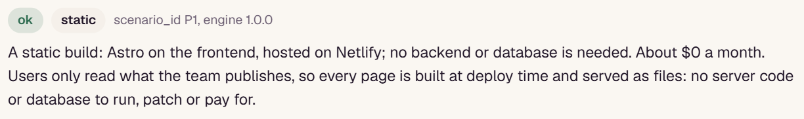

A solo beginner with $0, two weeks and critical SEO publishes pages nobody signs in to, so static options are allowed and the backend and database are "None", each with its reason. Astro (SEO 5/5) leads SvelteKit by 1.1 stack points, and Netlify's free static plan leads Cloudflare Pages by 1.1 and Vercel by 8.4 (no free option at this scale). `assumptions` notes that no search service is added because `full_text_search` is false.

### 6.2 P2 FixIt Now: home-services marketplace in India (in depth)

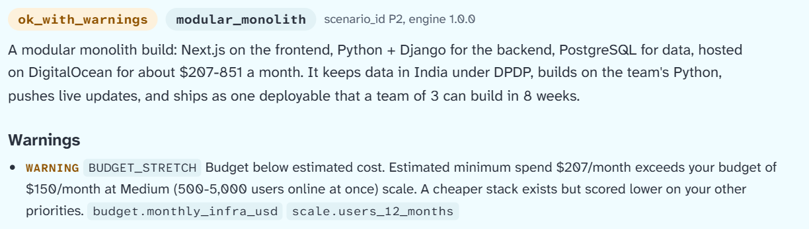

Three intermediate engineers (JavaScript, TypeScript, Python) with nobody on operations have 8 weeks and $150 a month for a marketplace with India residency, critical SEO, chat, phone sign-in, uploads, payments and search, sized at about 6,000 daily users and 12 requests per second at peak.

- **Hosting.** Residency removes Netlify, Render, Railway, Fly.io and Hetzner (no Indian region) and Cloudflare (Enterprise add-on needed) before scoring. DigitalOcean App Platform in BLR1 (Bangalore) leads Google Cloud Run by 1.0 stack point on cost at this scale (3.9 against 3.5) and realtime fit (4.0 against 3.0), and runs Django as long-running processes for the chat WebSockets. `driven_by` lists the answers that added the most points (`team.size`, `team.languages`, `priorities.time_to_market`, `priorities.cost`), then the constraint fields that ruled rivals out (`compliance`, `infrastructure.data_residency`, and `requirements.auth`, since signed-in users rule out a static host).
- **Frontend.** Critical SEO needs finished HTML. Next.js (SEO 5/5, in the team's languages) leads Nuxt by 2.3 points, and a React SPA loses 5.5 with a client-side rendering penalty. React Native (Expo) is the Android companion, because a mobile toolkit cannot be primary when web is a target.
- **Backend.** Django matches the team and runs one process for the WebSockets (Channels), jobs and connection pools. FastAPI is 0.1 behind, inside the tie margin, and the output says either is defensible; Spring Boot loses 10.5 because nobody knows Java. Trade-offs: realtime fit 2/5, a sync-first ORM.
- **Database.** The unstated data shape and consistency default to relational and strong, as `assumptions` notes. PostgreSQL (fit 5/5) on DigitalOcean Managed PostgreSQL costs $75 to $150 for about 50 GB with a standby; MySQL ties (0.3), MongoDB loses 6.5, and eventually consistent stores and single-node SQLite are ruled out.
- **Supporting services.** Celery with a Valkey broker; PostgreSQL full-text search, since 50 GB fits its own index; S3-compatible storage in India behind a CDN; MSG91 or Twilio Verify with the DLT-registered templates Indian operators require; Razorpay or Cashfree hosted checkout, keeping card data off the servers (PCI DSS SAQ A). A team of three runs at most two extra systems (Appendix A.5); this stack adds one, Valkey, and sign-in uses the framework's built-in accounts or a self-hosted Keycloak.
- **Cost.** $207 to $851 a month. The floor (hosting $75 with redundancy for 99.9%, database $75, Valkey $30, media $9, SMS $18) exceeds the $150 budget, so the output carries `BUDGET_STRETCH` and `ok_with_warnings`, stating that a cheaper stack scored lower on the stated priorities.

### 6.3 P3 BoardRoom: realtime collaborative whiteboard

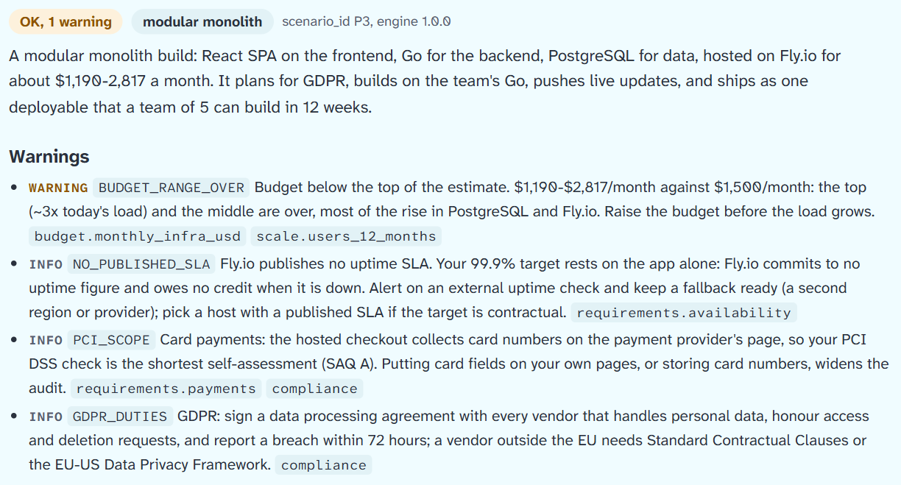

Five seniors (TypeScript, Go) build a write-heavy whiteboard for 5,000 concurrent users and a 100 ms target. Go matches the team; Elixir + Phoenix has the better realtime fit but loses 3.1 stack points because nobody knows Elixir. Fly.io holds long-lived WebSockets (realtime 5/5) and leads Cloud Run by 3.1. PostgreSQL leads Microsoft SQL Server by 2.1; MySQL takes a penalty because tenants share one database and its privileges stop at table and column level. Supporting services add Yjs shared documents (CRDTs), Redis pub/sub across instances, a cache, hosted checkout and social sign-in.

### 6.4 P4 QuickCredit: digital lending in India (in depth)

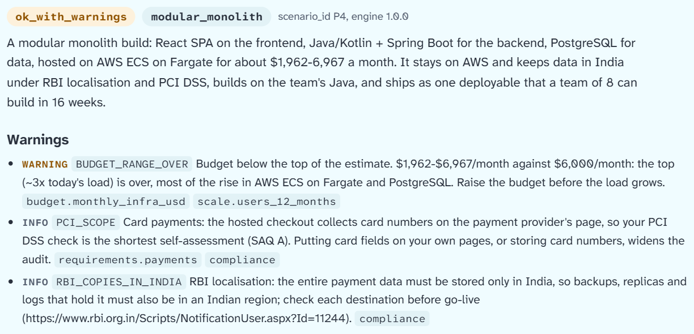

P4 is the most constrained scenario: AWS required, RBI localisation, PCI DSS, ISO 27001 and 99.95%, for eight seniors (Java, Kotlin, TypeScript) who can run infrastructure, sized at about 60,000 daily users and 833 requests per second at peak.

- **Hosting.** The explicit AWS removes Vercel, Netlify, Cloudflare, Render, Railway, Fly.io and Cloud Run before scoring, and S3 with CloudFront is static-only with a 99.9% SLA. ECS on Fargate leads Lambda by 2.9 stack points on performance and portability; its justification quotes the PCI DSS service-provider attestation, and the region is ap-south-1 (Mumbai). Trade-offs: AWS networking and IAM to learn, a load balancer and NAT gateway billed while idle, no AWS skill listed.
- **Backend.** Spring Boot matches the team and scores 5/5 on scalability, maturity and structure, which the load, the 99.95% target and the scalability and maintainability priorities weight up; Go is 3.0 behind on skill match. Supabase (not on AWS, no ISO 27001) and Firebase (not on AWS) are ruled out.
- **Database.** A double-entry ledger needs ACID, so eventually consistent stores are out; Firestore is off AWS and SQLite has no failover. PostgreSQL on Amazon RDS or Aurora in Mumbai costs $800 to $1,600 for about 500 GB with a standby; MySQL ties (0.1).
- **Frontend.** Behind a login SEO does not matter, so a React SPA ships as static files on S3 and CloudFront; Angular ties (0.8) and Next.js loses 1.2 for adding a Node.js server. Native iOS and Android apps (Swift, Kotlin) score best among mobile toolkits.
- **Supporting services.** The credit-scoring model on an Amazon SageMaker endpoint in Mumbai ($75 to $180, CPU); Cognito in Mumbai with an SMS gateway; hosted checkout; KYC files in a separate S3 bucket; KMS, audit logging, least-privilege IAM and a WAF for PCI DSS.
- **Cost.** $1,960 to $7,240 against $6,000, with hosting and the database doubled for 99.95%; the floor fits the budget, so the status is `ok` and the budget check reads "stretch".

### 6.5 P5 PeopleDesk: internal HR tool

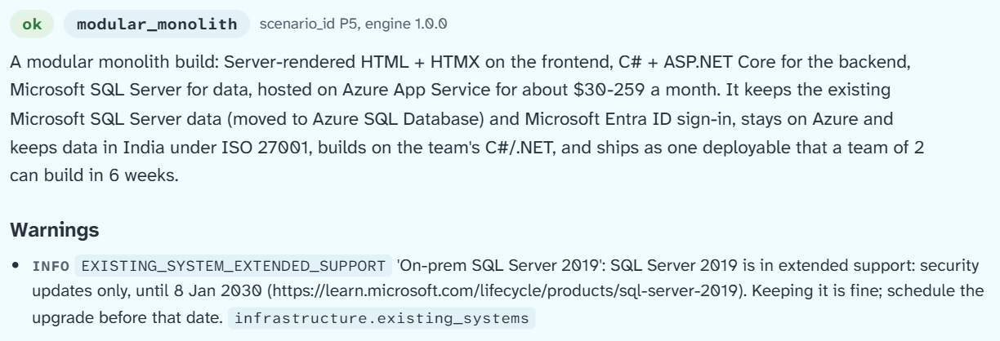

Two C# developers build a tool for 1,200 employees on Azure in India under ISO 27001, for $300 a month. Azure rules out every other host, and Supabase also lacks ISO 27001. ASP.NET Core leads Laravel by 3.7 points on the team's C# (skill match 4.5 against 3.5) and a 2.0-point compatibility rule for Microsoft's tooling on Azure; every backend the team writes itself takes the same identity-broker penalty for company sign-in, so the penalty does not separate them. HTMX leads a React SPA by 1.4. Existing systems are reused: sign-in through Microsoft Entra ID over OpenID Connect, SQL Server kept as Azure SQL Database, Microsoft 365 through the Graph API; an info warning notes that SQL Server 2019 security updates end on 8 January 2030.

### 6.6 P6 KhetSurvey: offline-first crop survey app

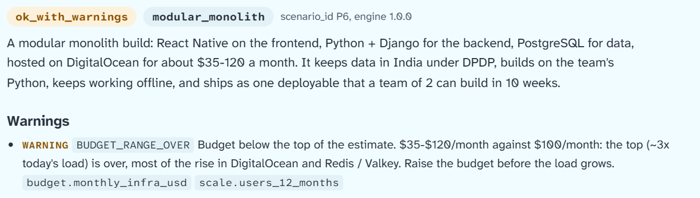

Two developers (JavaScript, Python) build an Android-only survey app that must work offline, in India, for $100 a month; type `other` on phones only is scored as a mobile-first app. React Native (Expo) leads Flutter by 3.5 points on skills, and PowerSync or ElectricSQL keeps a local SQLite copy in sync with PostgreSQL. Django and DigitalOcean in Bangalore win ties (0.5 and 0.6 points), and most of the cost is the database for about 100 GB of surveys and photos. The description's 2 GB phones and 2G/3G links are not read from the file; the offline flag carries that need.

## 7. Edge-case handling

The nine files in `scenarios/edge/` cover the nine categories of the statement's section 6. The screenshots after the table show each file's result on the Scenario file page, cut to the part that shows the handling.

| Category and file | How it is detected | What the engine does | Screenshot |
|---|---|---|---|
| Missing fields (E1: only name, type and platforms) | `validate()` collects absent required paths | Documented defaults, seven `MISSING_REQUIRED_FIELD` warnings, every default in `assumptions`; `ok_with_warnings` | E1 |
| Invalid values (E2: P2 with seven broken fields) | Type, range and enum checks per field | `invalid_input`, `stack` null, seven field-level `validation_errors` (unknown type and platform, −5 users, a string count, `magic_link`, a numeric availability, a priority of 7) | E2 |
| Contradictions (E3: five million users, $0, 99.99% from one beginner, three platforms in three weeks) | `engine/conflicts.py` compares fields; the cost model compares the cheapest compliant bill with the budget | Critical `BEGINNER_HIGH_AVAILABILITY`, `MANY_PLATFORMS_SHORT_TIMELINE` and `BUDGET_INFEASIBLE`; a reduced-scope stack, each relaxed goal in `assumptions`, its $9,200 floor stated | E3 |
| Over-engineering trap (E4: results page for two million readers, no sign-in) | No sign-in and a read-heavy workload allow static options | Astro, no backend or database, Netlify, $20 to $200; no Kubernetes or microservices | E4 |
| Regulatory constraints (E5: HIPAA, GDPR, PCI DSS, EU residency) | Compliance flags and regions per entry, checked before scoring | Cloud Run in Frankfurt with Cloud SQL; Firebase (no BAA), Vercel and Netlify (no SLA for 99.95%) out; sign-in under the Google Cloud BAA, hosted checkout, KMS, audit logs and a WAF | E5 |
| Existing systems (E6: Okta, SQL Server 2014, SAP ECC) | Free text matched to databases, identity providers, business systems and end-of-life products | Okta reused over OpenID Connect, SQL Server kept as Azure SQL, SAP integrated through OData; `EOL_EXISTING_SYSTEM` for SQL Server 2014 and Windows Server 2012 | E6 |
| Restricted deployment (E7: P2 with no internet) | `air_gapped` keeps self-hostable options; `AIR_GAPPED_EXTERNAL` finds outside dependencies | On-premises VMs, self-managed PostgreSQL, Ceph Object Gateway, nginx instead of a CDN, Keycloak, GitLab CI; payments, SMS and push moved outside or replaced (critical) | E7 |
| Skill mismatch (E8: P2 with a PHP-only team) | Skill match is weighted; an unknown server language takes a penalty | Laravel, HTMX and MySQL; Laravel leads FastAPI by 6.4 points on skill match, and its trade-offs note that high throughput needs Octane | E8 |
| Deprecated technology (E9: AngularJS 1.5, CentOS 7, Python 2.7, PHP 7.2) | An end-of-life table citing the vendor or endoflife.date | Four `EOL_EXISTING_SYSTEM` warnings with sources; each system integrated through its API | E9 |

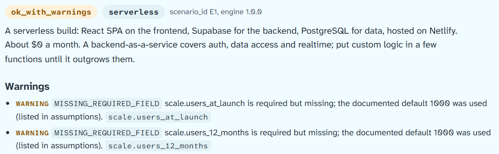

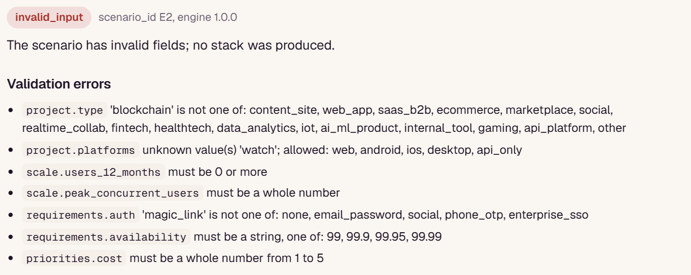

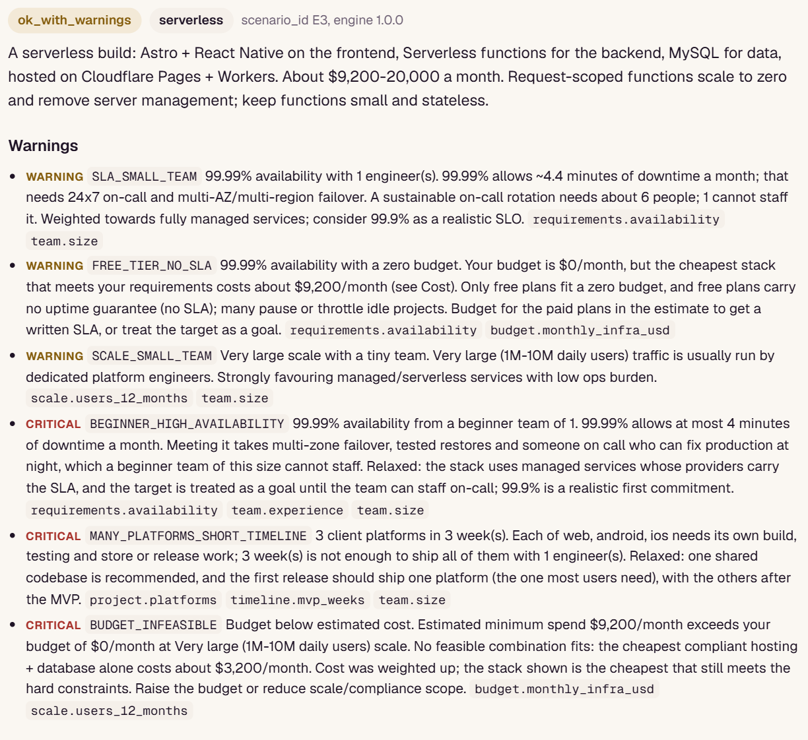

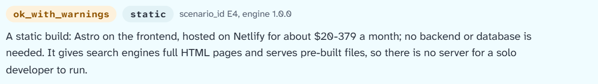

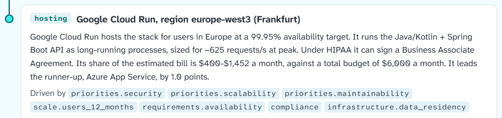

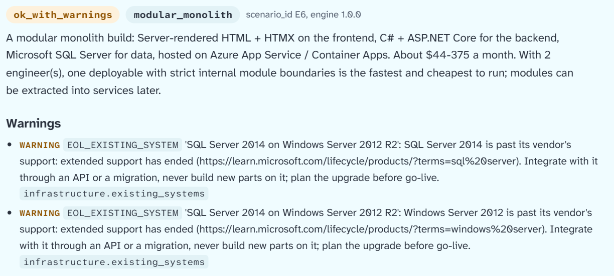

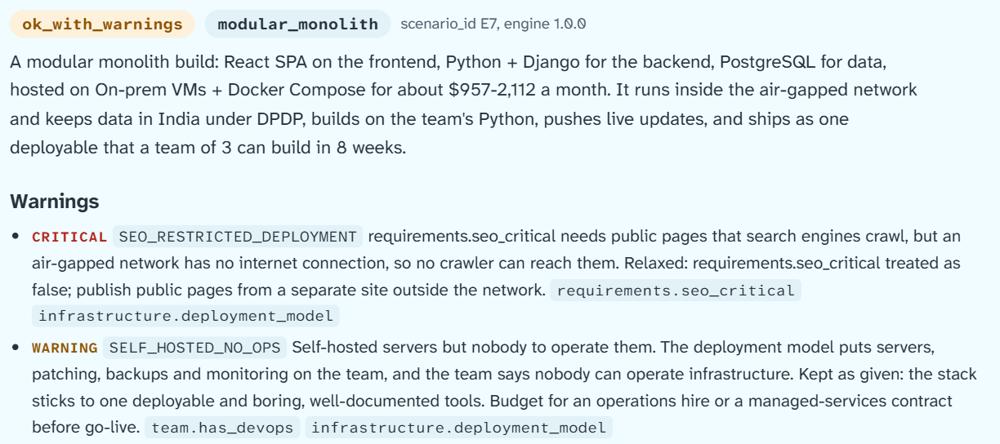

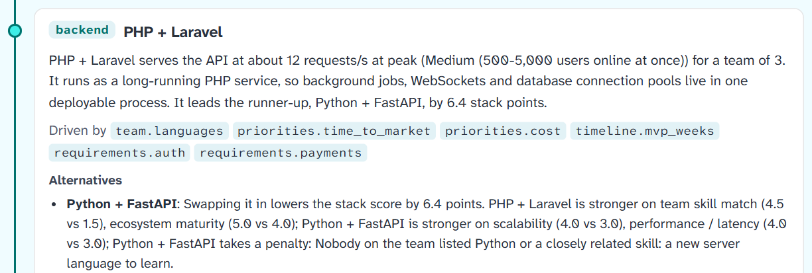

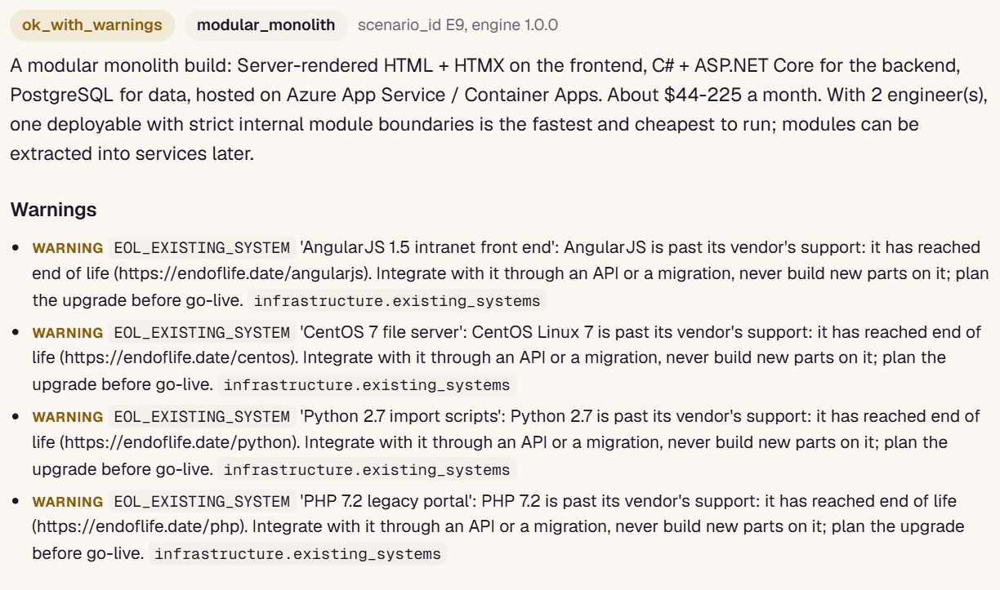

The adapter also raises `CLOUD_VS_DEPLOYMENT`, `RESIDENCY_CONFLICT` and `RESIDENCY_UNVERIFIED` (Section 5.3); a system on extended support, such as P5's SQL Server 2019, gets an info warning with its end date.

## 8. Validation

I checked the recommendations with a test suite, an answer key, an LLM-only baseline, a random-input property test and pairs of projects one answer apart. Appendix F has the tables behind 8.1 to 8.3.

### 8.1 Tests

The 1189 tests cover scoring, constraints and cost; explanations against the engine's numbers; inputs, edge cases and warnings; stability properties; the language-model checks and fallbacks; accuracy against the answer key; and the app, packaging and documents. `tests/test_edge_cases.py` fails if a warning code has no test that names it, and `tests/test_llm_off.py` fails if `outputs/` differs from the engine's output.

### 8.2 Benchmark against an answer key

`python tools/bench.py` scores the engine on 40 project briefs against an answer key written before measurement: a best pick and an acceptable set per layer, labelled by a language model playing three architect personas, blind to the engine. Result: 82% top-1 (129 of the 158 layer picks that have a best pick) and 96% acceptable (154 of all 160 layer picks); on the ten briefs held out from tuning, 72% and 95%. No human architect has checked the key.

### 8.3 LLM-only baseline

A language model with no rule engine picked the four layers for the same briefs (`python tools/llm_baseline.py`, an offline experiment, not part of the engine). Its agreement with the key is close to the engine's (LLM 84% top-1 on 158 picks, 94% acceptable on 160, against the engine's 82% and 96%), and the key's language-model origin may favour it. Graded by the rules, the model breaks a hard requirement in 7 of the 40 briefs, against none for the engine's picks graded the same way, and it gives no costs, reasons or sources.

### 8.4 Random projects and the public scenarios

`python tools/fuzz.py --n 1000 --growth-n 100` draws 1,000 seeded random projects (seed 2026, about three minutes on a laptop) and checks 15 properties against the knowledge-base files directly, not through the engine's filters: eight hard constraints (HIPAA, PCI DSS, residency, on-premises, mobile-only and API-only platforms, strong consistency, long-running workers), byte-identical repeats, invariance to renaming and reordering, agreeing USD and INR budgets, a warning for every relaxed layer and no crash. The result is 0 violations of the 15 properties, and the growth property, checked on 100 growth walks, is violated in 0 of them. Each public output also keeps its scenario's constraints: P1 costs $0, P2, P5 and P6 keep every store in India, and P4 runs on AWS in Mumbai.

### 8.5 One answer apart

Pairs of projects one answer apart check that a change moves only the layers it should, each with the engine's reason; Appendix D has three. Adding HIPAA to the startup example, for instance, replaces Supabase, whose plan with a BAA costs far more than the budget, and Cloudflare Pages, which offers no BAA. Among the edge scenarios, E8 changes only P2's languages and moves three layers to the PHP team's skills, while E7 changes only P2's deployment and cloud fields and keeps Next.js and Django.

## 9. Limitations and future work

- Prices and compliance attestations change, so a user should confirm them with each vendor; scores are judgements anchored to a rubric (Appendix C), not measurements.
- A language model wrote the benchmark labels, and with 10 held-out briefs one brief moves the rate by ten points.
- Niche options (CockroachDB, Oracle Database, Rust web frameworks such as Axum, desktop toolkits other than an Electron shell) are not scored; an existing Oracle database is acknowledged but cannot be the pick.
- Existing systems are matched by patterns: an unknown product only gets "integrated through its API", and one missing from the end-of-life table gets no warning.
- Daily users are 20% of the 12-month users for every project type; only the three highest priorities change weights; costs exclude egress spikes, support plans and most third-party fees.
- The random-project test covers the questionnaire path; the explicit-cloud and air-gapped rules have unit tests but no random-input property yet, and most supporting services list no alternative.

Next: an architect review of the answer key and the public outputs, scheduled re-reads of vendor price pages, a random-input property for every hard constraint through the scenario adapter, and alternatives for supporting services.

## 10. References and third-party tools

**Libraries.** [FastAPI](https://fastapi.tiangolo.com/) 0.142.2 (MIT), [Starlette](https://starlette.dev/) 1.7.0 (BSD-3), [Pydantic](https://docs.pydantic.dev/) 2.13.5 (MIT), [Uvicorn](https://uvicorn.dev/) 0.54.0 (BSD-3); tests: [pytest](https://docs.pytest.org/) 9.1.1 (MIT), [HTTPX](https://www.python-httpx.org/) 0.28.1 (BSD-3); report and screenshots only: [markdown-it-py](https://github.com/executablebooks/markdown-it-py) (MIT), [pypdf](https://github.com/py-pdf/pypdf) (BSD-3), [Playwright for Python](https://playwright.dev/python/) (Apache-2.0) and Google Chrome. The browser code uses no third-party JavaScript.

**Fonts.** In `app/static/fonts/` under the SIL Open Font License 1.1: [Atkinson Hyperlegible Next and Mono](https://github.com/googlefonts/atkinson-hyperlegible-next).

**APIs.** The optional [Google Gemini API](https://ai.google.dev/gemini-api/docs/openai) through its OpenAI-compatible endpoint (free tier); [OpenRouter](https://openrouter.ai/) can be configured instead. The client uses only the Python standard library.

**Datasets.** None shipped. The [Stack Overflow Developer Survey 2025](https://survey.stackoverflow.co/2025/technology) is the hiring-pool proxy; INR budgets use a fixed planning rate of 96 INR to 1 USD from the FBIL reference rate.

**Sources.** Every technology, rule, question and glossary entry cites official documentation, pricing or compliance pages; the register of 379 URLs is in `report/sources.md`. Main references: [expert systems](https://en.wikipedia.org/wiki/Expert_system), the [weighted sum model](https://en.wikipedia.org/wiki/Weighted_sum_model), counterfactual explanations ([Wachter, Mittelstadt and Russell, 2017](https://arxiv.org/abs/1711.00399)), [ISO/IEC 25010](https://www.iso.org/standard/78176.html), [AWS Well-Architected](https://aws.amazon.com/architecture/well-architected/), [ATAM](https://www.sei.cmu.edu/library/architecture-tradeoff-analysis-method-collection/), the Google SRE book ([availability table](https://sre.google/sre-book/availability-table/)), Fowler's [MonolithFirst](https://martinfowler.com/bliki/MonolithFirst.html), [Team Topologies](https://teamtopologies.com/key-concepts), [DORA research](https://dora.dev/research/), [HHS on HIPAA and cloud computing](https://www.hhs.gov/hipaa/for-professionals/special-topics/health-information-technology/cloud-computing/index.html), the [PCI SSC library](https://www.pcisecuritystandards.org/document_library/), the [MeitY data protection framework](https://www.meity.gov.in/data-protection-framework), the [RBI directive on payment data storage (2018)](https://www.rbi.org.in/Scripts/NotificationUser.aspx?Id=11244), [endoflife.date](https://endoflife.date/) and the [Microsoft lifecycle pages](https://learn.microsoft.com/lifecycle/).

**Repository.** <https://github.com/Paradox-73/StackSense26>. `python run.py` starts the app, `python -m pytest` runs the tests, `python tools/bench.py`, `tools/fuzz.py` and `tools/question_influence.py` rerun the studies, and `python tools/build_assets.py` then `tools/build_report.py` rebuild the tables and this PDF.

## 11. AI assistance declaration
- Claude Code (Anthropic), an AI coding assistant: used to write code and tests, to gather sources for the knowledge base and to draft documentation.
- Google's Gemini API (its OpenAI-compatible endpoint), inside the engine: used only to turn the free-text project description into suggested input fields that the user confirms or edits, and to reword explanations the engine has already produced. It never chooses a component: the stack comes from the engine's rules, scoring and decision tables (Section 5), and with the LLM-off switch the stack is identical.

## Appendix A. Decision rules in detail

### A.1 Criterion weights

Every project starts from the same baseline weight per criterion, and answers add contributions, each stored with its cause: `seo_critical` adds 4 to the SEO weight, a short timeline raises development speed, learning curve and skill match, a small team raises low operations burden, and priorities rated 4 or 5 raise their criteria, strongest first. Compliance maturity has zero weight unless HIPAA or PCI DSS data is in scope, and then grows with daily users, because breach-reporting duties and audit depth grow with volume.

### A.2 Hard constraints

An option is removed before scoring when it breaks a compliance rule (HIPAA BAA, PCI DSS attestation, SOC 2, ISO 27001), a residency rule, the deployment model, an explicit cloud, the platforms (a phone-only target rules out web frameworks), strong consistency for records that need it, the data shape, an in-memory store as the system of record for data that does not fit in RAM, a single-node database at a stated 99.9% or higher with real traffic, a host whose published SLA is below the stated availability, a static option when users sign in, post or pay, or the option's scale ceiling. Preference constraints are relaxed only if a layer would otherwise be empty, with a warning; compliance never is.

### A.3 Adjustments and the cost criterion

After the weighted average come adjustments with a stated reason: a minimum price above the layer's budget share costs 6 points per e-fold of overshoot (so 4 times over budget costs less than 40 times over); load near the scale ceiling, a team smaller than the option needs, a server language nobody listed and an in-memory store holding too much data also cost points. Cost at your scale is 5 − 4 × min(1, ln(1 + bill / share) / ln 31), where the share is 60% of the budget for hosting or the backend and 40% for the database: $0 scores 5 and 30 times the share scores 1. It depends only on the option's own bill, so it moves smoothly as users grow.

### A.4 Stack search, ties and growth

The top five options per layer give 625 stacks. The 65 compatibility rules add synergies (Next.js with Vercel, Supabase with Postgres, DynamoDB with Lambda), caveats (Lambda with Postgres needs RDS Proxy) and conflicts (WebSockets on Netlify or Lambda, DynamoDB off AWS, SQLite on hosts that run several instances). Ties within 1 stack point go to the fewest misses, then the preferred cloud, team skill match, the hiring pool when no skills are listed, the frontend's points from the most important answers and lower lock-in, then the higher score. Every run also works out the answer at all six scale tiers, smallest first, and passes over a stack that returns to a technology a smaller tier already left when one that does not is within 4 points of the top. If the chosen stack's minimum bill is over the budget, the best stack that keeps the same backend and database, fits the budget and scores at most 5 points lower replaces it. When the frontend platform runs server code only as short functions and the load or realtime needs a long-running API, the API gets its own host.

### A.5 Supporting services and cost lines

Supporting services follow the stack and the hard inputs: nothing cloud-only on-premises, nothing outside the residency region, nothing without a BAA under HIPAA. My estimate of how many extra systems a team can run beside its app and database is one for one or two people, two for three to five and four for six to twelve; the rest are listed with the trigger for adding them, and compliance and security services are never deferred. Each cost line states its basis: the price band for the scale tier, a multiplier for capacity the team runs itself (1.5 at 99.9%, 2 at 99.95%, 3 at 99.99%, for a stated target only), a database bill of at least its storage, add-ons at the app's own tier, and usage for model inference, video, maps, SMS and media delivery.

<!-- INSERT appendix-b -->

## Appendix C. Score rubric

Every technology score is an integer from 1 (poor) to 5 (excellent) for that criterion. Scores are curated by hand from the vendor documents listed on each technology; they are judgements anchored to the definitions below, not measurements.

| Criterion | Meaning | 1 | 3 | 5 |
|---|---|---|---|---|
| ease | How gentle the learning curve and first setup are | Weeks of study before a first working feature | A few days with the official tutorial | A working app in an afternoon from a quickstart |
| ops | How little operational work the team does (patching, scaling, backups) | The team runs servers, upgrades and backups itself | Managed service, but the team tunes capacity and configuration | Fully managed; nothing to patch or scale by hand |
| maturity | Years in production use, stability of the API, size of the ecosystem | Under 2 years old or breaking changes every release | 3 to 7 years, stable core, smaller ecosystem | 10+ years, long-term support releases, very large ecosystem |
| performance | Typical speed and resource use under load for this layer | Noticeably slower or heavier than peers in public benchmarks | Average for its category | Among the fastest in its category in public benchmarks |
| scalability | How far it grows before a redesign is needed | Single machine or tens of requests per second | Thousands of requests per second with standard tuning | Documented use at hundreds of thousands of requests per second or more |
| realtime | Support for long-lived connections and live updates | No persistent connections; polling only | Possible with an add-on service or beta feature | Built in and documented for production use |
| seo | Whether crawlers receive finished HTML | Client-side rendering only | Server rendering available but not the default or needs extra setup | Server or static rendering by default |
| velocity | How quickly a small team ships features | Much boilerplate; every feature is custom work | Good libraries for common needs, some glue code | Batteries included: auth, data access and admin come ready |
| hiring | Size of the pool of developers who already know it | Fewer than 1 in 50 developers in public surveys | About 1 in 10 developers | More than 1 in 4 developers |
| structure | Support for keeping a large codebase organised | No conventions; structure is up to each developer | Conventions exist but are optional | Opinionated structure enforced by the framework |
| interactivity | Fit for rich, stateful user interfaces | Page-at-a-time rendering only | Sprinkled interactivity with some client state | Component model built for complex client state |
| offline | Support for working without a network connection | Needs a connection at all times | Can cache data; sync is hand-written | Built-in local storage and sync |

Scores of 2 and 4 sit between the anchors. The rubric is a reading guide: the sources for each technology are in `report/sources.md`, and the rules and weights that combine the scores are in the knowledge base and `engine/scoring.py`.

## Appendix D. Knowledge-base evidence and more samples

<!-- BEGIN evidence -->
The table prints the knowledge-base facts for the hosting options that the six public scenarios pick or rank second, and for their two database picks; `tools/build_assets.py` generates it from `data/kb/`. SLA is the highest uptime that the vendor's SLA page commits to. India and EU mark a region that meets a data-residency rule. A price in the BAA column is the least a month at which the vendor signs one. Ops is the operations-burden score from Appendix C, where 5 means the least work. Cost is the monthly band at the scale tier Medium (10k-100k daily users or 50-500 req/s at peak), for the app alone on a host and for the managed service on a database. A managed database takes the SLA, regions and attestations of the host's service, so those cells read host. The source column gives the vendor's compliance and SLA pages, or the database's documentation; `report/sources.md` lists every other source.

| Option | SLA | India | EU | HIPAA BAA | PCI DSS | ISO 27001 | Ops | Cost a month | Source |
|---|---|---|---|---|---|---|---|---|---|
| Netlify | none | no | yes | no | yes | yes | 5/5 | $40–$300 | <https://www.netlify.com/security/> |
| Cloudflare Pages + Workers | none | no | no | no | yes | yes | 5/5 | $5–$25 | <https://www.cloudflare.com/trust-hub/compliance-resources/> |
| DigitalOcean (App Platform + Managed DBs) | 99.95% | yes | yes | no | no | no | 5/5 | $50–$250 | <https://www.digitalocean.com/trust> <https://www.digitalocean.com/sla/app-platform> |
| Google Cloud Run | 99.95% | yes | yes | yes | yes | yes | 5/5 | $60–$400 | <https://cloud.google.com/security/compliance/offerings> <https://cloud.google.com/run/sla> |
| Fly.io | none | no | yes | from $99 | no | no | 4/5 | $30–$250 | <https://fly.io/docs/about/healthcare/> |
| AWS ECS on Fargate | 99.99% | yes | yes | yes | yes | yes | 3/5 | $120–$400 | <https://aws.amazon.com/compliance/programs/> <https://aws.amazon.com/ecs/sla/> |
| AWS Lambda + API Gateway | 99.95% | yes | yes | yes | yes | yes | 5/5 | $30–$400 | <https://aws.amazon.com/compliance/programs/> <https://aws.amazon.com/lambda/sla/> |
| Azure App Service / Container Apps | 99.99% | yes | yes | yes | yes | yes | 4/5 | $100–$500 | <https://learn.microsoft.com/azure/compliance/> <https://www.microsoft.com/licensing/docs/view/Service-Level-Agreements-SLA-for-Online-Services> |
| PostgreSQL | host | host | host | host | host | host | 4/5 | $50–$400 | <https://www.postgresql.org/docs/current/> |
| Microsoft SQL Server | host | host | host | host | host | host | 4/5 | $150–$800 | <https://learn.microsoft.com/en-us/sql/sql-server/> |
<!-- END evidence -->

The guided questionnaire runs the same engine on its own answers. Two screenshots of its result page and three one-answer-apart pairs follow, with changed layers in bold and the engine's reason.

<!-- BEGIN gallery -->
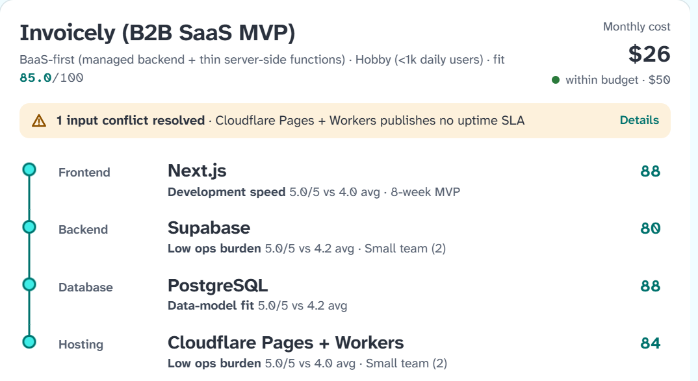

**Startup SaaS MVP.** Next.js (React) + Supabase (BaaS on Postgres) + PostgreSQL + Cloudflare Pages + Workers, about $26 a month.
Why it fits: backend, low ops burden: 5.0/5 vs 4.2 average for this layer; hosting, low ops burden: 5.0/5 vs 4.0 average for this layer.
<!-- END gallery -->

<!-- BEGIN gallery_more -->

**HIPAA telehealth platform.** React SPA (Vite) + Python + Django + PostgreSQL + AWS ECS on Fargate, about $370–$1,815 a month.
Why it fits: backend, ecosystem maturity: 5.0/5 vs 4.4 average for this layer; hosting, realtime fit: 4.0/5 vs 3.4 average for this layer.
<!-- END gallery_more -->

<!-- BEGIN pairs -->
**Startup SaaS MVP, then add HIPAA** (preset `startup_mvp`; changed answer: `compliance`: gdpr → gdpr, hipaa)

| Layer | Before | After |
|---|---|---|
| Frontend | Next.js (React) | Next.js (React) |
| Backend | Supabase (BaaS on Postgres) | **Node.js + Express** |
| Database | PostgreSQL | PostgreSQL |
| Hosting | Cloudflare Pages + Workers | **Google Cloud Run** |
| Est. cost / month | $26 | $22–$85 |

- Backend: Supabase (BaaS on Postgres) now takes a penalty (Minimum ~$584/month is 11.7x the whole budget), moving the gap 17.8 points toward Node.js + Express; cost at your scale moved the gap 11.1 points toward Node.js + Express (Node.js + Express 5.0/5 vs Supabase (BaaS on Postgres) 1.5/5, was 5.0 vs 4.8).
- Hosting: Cloudflare Pages + Workers is now ruled out: No HIPAA Business Associate Agreement available.
<!-- END pairs -->

<!-- BEGIN pairs_more -->
**IoT telemetry, 40,000 devices vs 5 million** (preset `iot_telemetry`; changed answer: `dau`: 40,000 → 5,000,000)

| Layer | Before | After |
|---|---|---|
| Frontend | React SPA (Vite) | React SPA (Vite) |
| Backend | Go (net/http, chi or Gin) | Go (net/http, chi or Gin) |
| Database | TimescaleDB (Postgres) | TimescaleDB (Postgres) |
| Hosting | AWS ECS on Fargate | AWS ECS on Fargate |
| Est. cost / month | $1,365–$7,700 | $38,500–$140,000 |

**Internal tool, own servers vs cloud** (preset `internal_tool`; changed answer: `deployment`: on_prem → cloud)

| Layer | Before | After |
|---|---|---|
| Frontend | Server-rendered HTML + HTMX | Server-rendered HTML + HTMX |
| Backend | Python + Django | Python + Django |
| Database | SQLite (+ Litestream backups) | SQLite (+ Litestream backups) |
| Hosting | On-prem VMs + Docker Compose | **Render** |
| Est. cost / month | $0–$150 | $7 |

- Hosting: On-prem VMs + Docker Compose is now ruled out: On-premises option; you chose public cloud.
<!-- END pairs_more -->

## Appendix E. Input research in detail

**Coverage of the quality-attribute frameworks.** Each row is a quality attribute, the matching ISO/IEC 25010:2023 characteristic and Well-Architected pillar, the inputs that capture it, and what scores it. The 2023 edition renamed Usability to Interaction capability and Portability to Flexibility, and added Safety.

| Quality attribute | ISO/IEC 25010 | Well-Architected | Inputs that capture it | Criteria or hard filters |
|---|---|---|---|---|
| Performance | Performance efficiency | Performance efficiency | users, peak requests per second, users online at once, traffic pattern, cacheable share, latency target, read and write mix | performance, scalability, scale ceiling |
| Reliability | Reliability | Reliability | availability target, consistency, team experience, someone can operate infrastructure | scalability, operations burden, SLA filter, redundancy cost |
| Security and compliance | Security | Security | compliance (seven regimes), data residency (India, EU, US), company sign-in, air-gapped deployment | compliance maturity, region coverage, BAA, attestation and region filters |
| Cost | (none) | Cost optimisation | budget, currency, priorities | cost at your scale, budget guard |
| Operability | Maintainability | Operational excellence | team size and experience, someone can operate infrastructure, self-managed cloud VMs, architecture preference | operations burden, minimum team, extra-systems budget |
| Team fit | Maintainability | (none) | team skills and experience, time to MVP, team size | skill match, learning curve, development speed, hiring pool, structure, maturity |
| Portability and lock-in | Flexibility | (none) | lock-in tolerance, deployment model, preferred cloud, must use this cloud | portability, deployment and cloud filters |
| Compatibility | Compatibility | (none) | existing systems, client platforms (desktop and API only included), deployment model | existing-system bonus, identity reuse, platform filter, compatibility rules |
| Functional fit | Functional suitability | (none) | application type, what users do, special workloads, background work, machine learning, tenancy, data shape, realtime, SEO, offline | data-model fit, realtime, SEO, interactivity, offline |
| User experience | Interaction capability | (none) | latency target, realtime, offline, client platforms | performance, interactivity, realtime, offline, platform filter |

Safety (new in 2023) is not scored: the four layers are infrastructure, and no option changes whether the product can harm people or property. Health data is covered under Security.

**ATAM in this engine.** The Architecture Tradeoff Analysis Method's utility tree is the set of criterion weights; its scenarios are the six public scenarios, the nine edge scenarios, the 14 presets and the 40 benchmark briefs; its sensitivity points are what "Not sure" and the question-influence study find; and its trade-off points are the contradiction warnings and the compatibility rules that cost points on one layer to gain on another.

**Inputs deliberately not asked.** Sustainability and carbon (no vendor publishes a comparable figure per workload, so a score would be invented), interface design and accessibility (StackSense picks infrastructure layers), CI/CD, testing and monitoring vendors (they follow from the stack and appear as supporting services), start-up credits (they vary by programme and date, so costs could not be reproduced), and tool taste such as "I like Svelte" (skills are asked, taste is not).

## Appendix F. Validation in detail

### F.1 Tests by area

<!-- BEGIN validation -->
| What is checked | Tests |
|---|---|
| Scoring, constraints and cost | 414 |
| Explanations match the engine | 130 |
| Inputs, edge cases and warnings | 276 |
| Stability and properties | 76 |
| Language-model layer (checks and fallbacks) | 192 |
| Accuracy against the answer key | 9 |
| App, packaging and documents | 92 |
| **All** | **1189** |
<!-- END validation -->

`report/validation.md` lists every test file with its count.

### F.2 Benchmark against an answer key

<!-- BEGIN bench -->
- **Benchmark against an answer key** (`python tools/bench.py`, `tests/test_benchmark.py`): 40 project briefs, each with a best pick and an acceptable set per layer, from an answer key written before measurement, with sources. The labels were written by a language model playing three architect personas (a startup CTO, an enterprise architect, a cloud engineer), blind to the engine, not by human raters. A pick counts as acceptable if at least 2 of 3 personas accept it. The personas agree on the best pick 92% of the time (Krippendorff alpha 0.91, a measure of agreement between the personas, not between human raters). 10 briefs were held out and never used for tuning.

| Layer | Tuning top-1 | Tuning acceptable | Held-out top-1 | Held-out acceptable |
|---|---|---|---|---|
| frontend | 100% (30/30) | 100% (30/30) | 80% (8/10) | 90% (9/10) |
| backend | 86% (25/29) | 93% (28/30) | 80% (8/10) | 100% (10/10) |
| database | 80% (24/30) | 97% (29/30) | 70% (7/10) | 100% (10/10) |
| hosting | 72% (21/29) | 97% (29/30) | 60% (6/10) | 90% (9/10) |
| All layers | 85% (100/118) | 97% (116/120) | 72% (29/40) | 95% (38/40) |

Before the general rule fixes made on the 30 tuning briefs, the held-out briefs scored 60% (24/40) top-1 and 80% (32/40) acceptable. The picks outside the acceptable set are listed by `python tools/bench.py --briefs`.
<!-- END bench -->

Top-1 is scored on 158 of the 160 layer picks, because the personas have no majority for the backend and hosting of brief A05. A language model wrote the key, so it may favour the LLM-only baseline below; no human architect has checked it.

### F.3 LLM-only baseline

<!-- INSERT llm-baseline -->

