# StackSense

<!-- The cover page (title, author, links) is generated from report/cover.json by tools/build_report.py. -->

## At a glance

StackSense recommends a frontend, backend, database and hosting platform from a project's scale, data, team, budget, infrastructure and compliance constraints. Each pick comes with a score, the answers that produced it, the runner-up it beat, what would change it, and a monthly cost. A rule engine makes every decision, so the same answers always give the same stack. An optional language model (LLM) only reads a free-text project description and words a summary, and code checks both. With no API key the whole app still works, offline.

**Three numbers to check first**

| Proof | Result | Where it comes from |
|---|---|---|
| Agreement with an answer key written by a language model in three architect personas, blind to the engine (not human raters) | 96% of the 160 layer picks (one pick each for frontend, backend, database and hosting, over 40 briefs) are acceptable to at least 2 of 3 personas; 72% top-1 and 95% acceptable on the 10 briefs I never tuned on | Section 6.1; `python tools/bench.py` |
| Hard constraints under attack | 0 violations of the 14 properties (hard constraints, meaning rules that remove an option before any scoring; consistency; and no return to an earlier pick as users grow) in 10,000 random projects; 0 of 1,000 growth walks returns to an earlier pick | Section 6; `python tools/fuzz.py` |
| Tests | 917 tests pass, and every warning code the engine can raise has a test that triggers it | Section 6; `python -m pytest` |

**Where each judging criterion is answered**

| Criterion (weight) | Where to look | Proof in the repository |
|---|---|---|
| Recommendation quality (35%) | Section 4 (sample recommendations, one-answer-apart pairs), Section 6 (validation, LLM-only baseline), page [[page:4. Sample recommendations]] | 14 presets (built-in example projects) in `report/samples/`, 40-brief benchmark, 10,000-project random test |
| Input design and research (30%) | Section 2 (research, free-text description, "Not sure"), Appendix B (all 42 questions with measured influence), Appendix E (framework coverage), page [[page:2. Input parameters and the research behind them]] | `tools/question_influence.py`: 8,159 engine re-runs; `engine/brief.py` |
| Reasoning and explainability (20%) | Section 3 (why panel, why-not, stability, checked plain-English summary), page [[page:3. Reasoning and explainability]] | `tests/test_faithfulness.py`, `tests/test_whynot.py`, `tests/test_summary.py` |
| Documentation and demo (15%) | This report, the README, the demo video (link on the cover), Appendix G (tools and licences) | `python tools/build_report.py` rebuilds this PDF from the code |

<!-- TOC -->

## 1. System design

### 1.1 A hybrid design: rules decide, the language model reads and explains

A language model can name a plausible stack, but on its own it cannot show a score trace that can be re-run, may answer the same question differently twice, and has no notion of a hard constraint. A pure rule engine has the opposite weakness: it needs the user to fill in a form. I split the work so that each part does what it is good at:

- **The rule engine decides.** Every score, exclusion, pick, cost and "what would change it" comes from the rule engine and the JSON knowledge base. The model never adds, removes or reorders a recommendation.
- **The model works at the edges.** It reads a free-text project description into questionnaire answers, and it re-words the engine's own facts as a short plain-English summary. It also maps a "what if..." question to an input change that the engine re-runs, and, on request, proposes its own stack as a second opinion that the engine grades (Section 6.2 shows why the engine grades it instead of trusting it).
- **Code checks everything the model returns,** before anything is shown (table below).

| Where | What the model does | What the code checks | With no key or a failed call |
|---|---|---|---|
| Describe your project (`engine/brief.py`) | Reads a paragraph into answers, only for questions the pattern reader left open | The value must be one the questionnaire accepts, and must come with a quote that occurs in the user's text; otherwise it is dropped | The pattern reader (`engine/brief_rules.py`: numbers, money, skills, regions, compliance words, app-type keywords) still fills what it can |
| Plain-English summary (`engine/summary.py`) | Re-words the engine's facts as one short paragraph per layer plus an overall one | Every technology name and every number must appear in the engine's facts. One retry shows the model its errors; a second failure falls back | The engine's template explanation, badged "template fallback" instead of "checked against engine facts" |
| What if... in words (`engine/whatif.py`) | Maps "what if we had ten times the users?" to answer changes | Same schema and quote rule as the brief reader; the engine then re-runs on the changed answers | Numbers and clear phrases ("team of 8", "budget $0") still work through the pattern reader |
| Second opinion (`engine/second_opinion.py`) | Chooses its own stack for the user's answers, from the knowledge base's technology ids | The engine grades that stack with `why_not`: hard-requirement breaks, score gap and cost difference against its own pick. The model's stack is never the recommendation | The button is disabled with a note; nothing else changes |

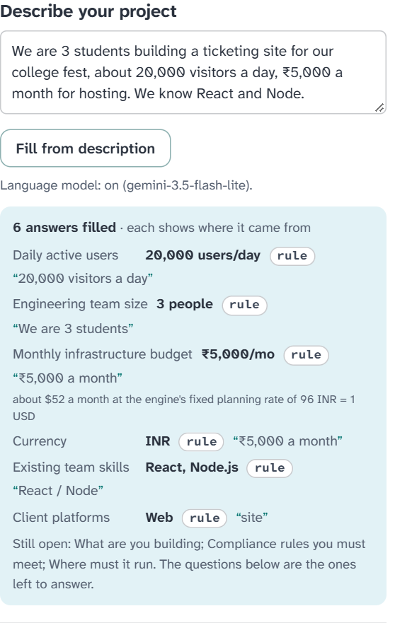

On this description the pattern reader filled all six answers and the model, which was on, added none, so every answer is marked "rule". A model answer would be marked "LLM" and shown with its quote in the same way.

**Why this design.** The engine is deterministic, and model replies are saved on disk (one small JSON file each, keyed by a hash of the model list and the messages, at temperature 0, meaning no random sampling), so a reviewer's machine gives the same answer. The tests replace the network with a fake transport and cover the no-key fallbacks, an invented technology, an invented number, a quote that is not in the text and a value outside the schema. A model answer cannot change a pick, because the pick is computed after the answers are checked.

The rule engine itself keeps the three properties a judge, an architect or a CTO can check:

1. **Deterministic.** The same inputs give the same output. Nothing is sampled. `tests/test_invariants.py` and `tools/fuzz.py` check that two runs give byte-identical output.
2. **Traceable.** Each score is a weighted sum, and each weight is a sum of contributions from specific answers. The UI shows which answer added or removed how many points.
3. **Constraint-safe.** Compliance and deployment rules remove options before scoring. A HIPAA project (US health-data rules) never gets a host that has no Business Associate Agreement, the contract a host signs to handle health data, however cheap it is.

StackSense is an *expert system* ([Wikipedia](https://en.wikipedia.org/wiki/Expert_system)): a knowledge base (`data/kb/*.json`: 60 technologies with sourced scores and 62 compatibility rules), an inference step (constraint filtering, a *weighted sum model* score ([Wikipedia](https://en.wikipedia.org/wiki/Weighted_sum_model)), then a search over stacks) and an explanation step. The "what would change it" panel is a *counterfactual explanation* ([Wachter, Mittelstadt and Russell, arXiv:1711.00399](https://arxiv.org/abs/1711.00399)): the smallest change to the input that changes the output.

### 1.2 Components and pipeline

- **Browser** (`app/static/`): plain HTML, CSS and JavaScript with no build step and no third-party script. The form is rendered from `data/questions.json`, which defines each question's options, default, range, help text, "why we ask" note and sources. The engine reads its defaults from the same file, so the two cannot drift apart.
- **FastAPI app** (`app/main.py`): JSON endpoints (Appendix H.3), with interactive docs at `/docs`.
- **Engine** (`engine/`, pure Python): `profile.py`, `conflicts.py`, `scoring.py`, `stack.py`, then `explain.py`, `advice.py` and `recommender.py`. The language-model client (`llm.py`) uses only the standard library and sits outside the decision path.
- **Data** (`data/`): one JSON file per layer with 60 technologies, the rules, the questionnaire, the glossary, the presets and the score rubric. Every technology and rule cites its sources (344 URLs in `report/sources.md`).

Seven stages turn answers into an explained recommendation: normalise the answers, derive load and scale tier, detect contradictions, weight the criteria, filter then score, search stacks, explain. Appendix H describes each stage.

---

## 2. Input parameters and the research behind them

Input design is where most recommenders are weakest: they ask for "scale" and "budget" and stop. I collect what changes an architecture decision, say why each question is asked, measure whether it does change a decision, let users describe the project in their own words, and handle users who do not know the answer.

### 2.1 Method

1. **Start from quality-attribute frameworks.** I listed the quality attributes that three standard frameworks use to judge an architecture and asked which project facts a recommender needs to score each: ISO/IEC 25010 ([ISO](https://www.iso.org/standard/78176.html)), the AWS Well-Architected Framework ([AWS](https://aws.amazon.com/architecture/well-architected/)) and the Architecture Tradeoff Analysis Method, ATAM ([SEI](https://www.sei.cmu.edu/library/architecture-tradeoff-analysis-method-collection/)). Appendix E maps each attribute to the questions that capture it.
2. **Add what only a tech-stack choice needs.** Team skills, existing systems, data shape, client platforms and compliance regimes remove or favour options more than any quality attribute does.
3. **Keep a question only if it changes a decision.** I re-ran the engine 8,159 times, changing one answer at a time on the 14 presets and on 40 seeded random projects (`tools/question_influence.py`). A question that never changed a pick, a cost or a warning would be dropped, and `tests/test_questions.py` fails if one is added that does nothing.
4. **Give every question a fallback.** Each has a default, a range, a "Help me choose" hint, a "why we ask" note with a source, and (except currency) a "Not sure" option.

The questions fall into five groups: product, scale and data, experience and reliability, team and delivery, and budget and constraints. Four were added late: how many users are online at the same moment at peak, whether work runs in the background (jobs over 15 minutes, GPU work), whether several customer organisations share the app (tenancy), and whether customers sign in with their company account (single sign-on, SSO). Appendix B lists all 36 with their type, default, source and measured influence; Appendix E gives the group-by-group reasoning with sources.

### 2.2 Describe the project in words: fewer questions to answer

A form with 42 questions is accurate but slow. The "Describe your project" box lets a user type a paragraph and press "Fill from description". The page marks where each filled answer came from, and only the rest are left to ask.

- **Pattern reader first.** `engine/brief_rules.py` reads numbers ("5,000 patients a day", "team of 4"), money ("$3,000 a month", which also sets the currency), skills, regions, compliance words and app-type keywords. It needs no network and never guesses.
- **Model second, only for open questions.** If a key is set, the language model may fill questions the pattern reader left open. Its value is kept only if it is valid for that question and it quotes words that really occur in the user's text. Otherwise it is dropped.
- **Every filled answer shows its source and quote.** The page marks each one as read by a rule or by the model and shows the quoted words. The user can still edit it by hand, and an answer edited by hand is no longer marked as read from the text.
- **Measured example.** The pattern reader alone turns "A telehealth app for 5,000 patients a day in the US. It handles patient records, so it must be HIPAA compliant. Team of 4 who know Python and React, budget about $3,000 a month." into 8 filled answers (app type, daily users, team size, skills, regions, compliance, budget, currency), each with its quote. The other questions keep their documented defaults and stay listed as assumptions.

### 2.3 Two depths: quick mode and refine

- **Quick mode** asks seven questions a new user can answer without research: what you are building, daily users, monthly budget, team size and languages, compliance, where it must run, and four must-haves (live updates, offline, found on Google, mobile app). A stack appears on page load and updates about 250 ms after each answer. "Ask me only what matters" lists the unanswered questions that can still change a pick, or says that no single remaining answer does.
- **Refine** opens all 42 questions in five groups. On desktop the result stays pinned beside the form.
- **How much each question matters** was measured (`report/question_influence.md`). A re-run counts when at least one of the four picks changed. Team skills changed a pick in 90% of re-runs (an upper bound, because skills are varied as whole sets), data shape in 65%, an air-gapped network in 63%, deployment model in 51%, client platforms in 49%, team size in 36%, budget in 19%, daily users in 21% and compliance in 11%. The least influential are the traffic pattern (2%), the cacheable share (2%), where users are (1%), company single sign-on (1%) and machine-learning features (1%, which mostly add a model-serving service and its cost); the rest, with the share of re-runs that changed each layer, are in Appendix B.

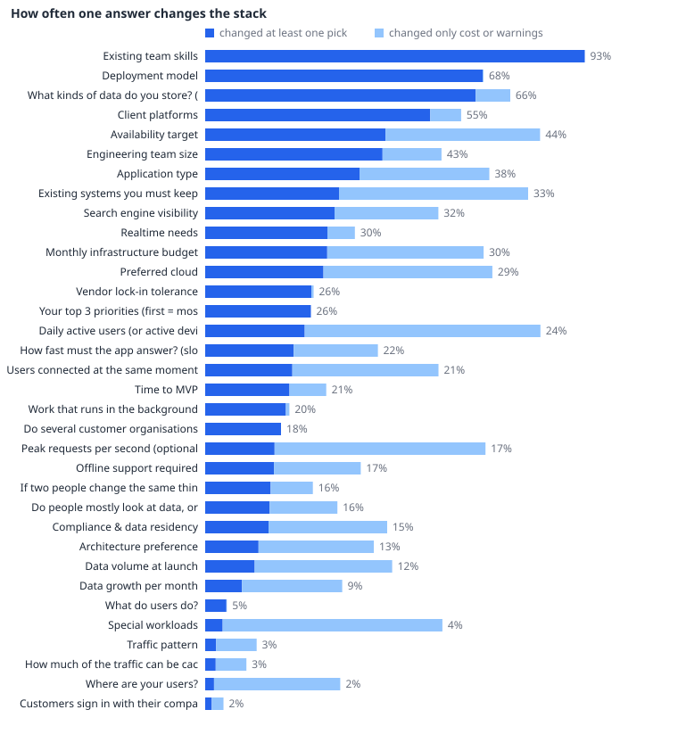

### 2.4 When the user does not know: "Not sure" and "Depends on"

Every question except currency has a **Not sure** option. StackSense then uses the default, marks the answer as unknown, and re-runs the engine across that answer's plausible values (capped at 48 runs). The **Depends on** panel reports, per layer:

- **Robust:** the pick is the same whatever the answer is, so the user can commit to it now.
- **Depends:** the value at which the pick flips, with a one-click *Pick* button to set the answer and the cause of the flip.

This turns uncertainty into a decision aid. In the figure, a start-up that is unsure about its daily users keeps its frontend (Next.js), database (PostgreSQL) and hosting (Cloudflare Pages + Workers) whatever the number is, marked Robust. Only the backend depends on it: Supabase up to 1 million users a day, Node.js + Express from 10 million.

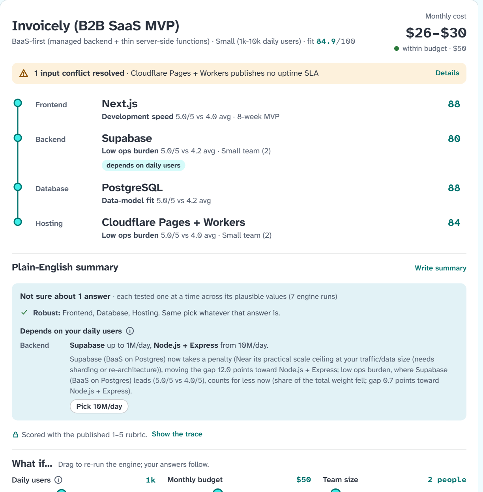

Every technical term (HIPAA, DPDP, PCI-DSS, DAU for daily active users, p95 latency for the response time that 95% of requests beat, BaaS for a ready-made hosted backend such as Firebase, lock-in, data residency and more) has an (i) button with a plain-English definition, who it applies to and an official source (`data/glossary.json`, 43 glossary terms).

---

## 3. Reasoning and explainability

Every pick answers four questions: why this one, why not the runner-up, what would change it, and how sure the engine is.

| Feature | What the user sees |
|---|---|
| Justification paragraph | 3 to 5 sentences per layer, built from fixed templates that quote the project's own numbers and facts from the knowledge-base entry (BAA, long-running processes, consistency, data-model fit) |
| Per-answer trace | A bar chart of which answers added or removed points; the bars sum to the score |
| Runner-up comparison | The option it beat, by how many stack points, and on which criteria; the listed contributions add up to the margin, labelled clear (4+ points), solid (1.5 to 4) or close call (under 1.5) |
| Why not X | The runner-up, the layer's top scorer and the widely used options, each with the stack gap or the rule that excludes it; any option or whole stack can be pinned |
| Counterfactuals | Up to 14 single-answer changes re-run through the engine; only the ones that change the stack are shown, each with its cause |
| Live what-if | Sliders for users, budget and team size, and a box that takes the question in words; changed picks turn gold with the reason |
| Growth path | The stack at 1x, 10x and 100x the users, where each layer changes, and the cost at each step |
| How stable is this pick | 30 seeded re-runs per noise level with every knowledge-base score shifted by up to 0.25 and 0.5 points, counting how often each pick holds |
| Decision records | One architecture decision record per layer: context, decision, alternatives considered, consequences, when to revisit |
| Plain-English summary | One short paragraph per layer and an overall one, worded by the model from the engine's facts and badged "checked against engine facts" |

**The summary is checked, not trusted.** The model receives only the engine's result: picks, scores, reasons, rejected options, cost and warnings. `engine/summary.py` then rejects any text that names a technology or states a number that is not in those facts (`1,000`, `1k` and `$25` count as the same kind of number). The model gets one retry with its errors shown; after a second failure, or with no key, the page shows the engine's template text, badged "template fallback". The other explanations do not use a model: `tests/test_faithfulness.py` checks every score, margin and figure quoted in the text against the structured result on the 14 presets and 120 random projects, and `tests/test_explanations.py` requires the per-answer contributions to add up to each score and margin.

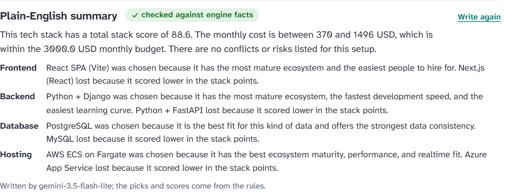

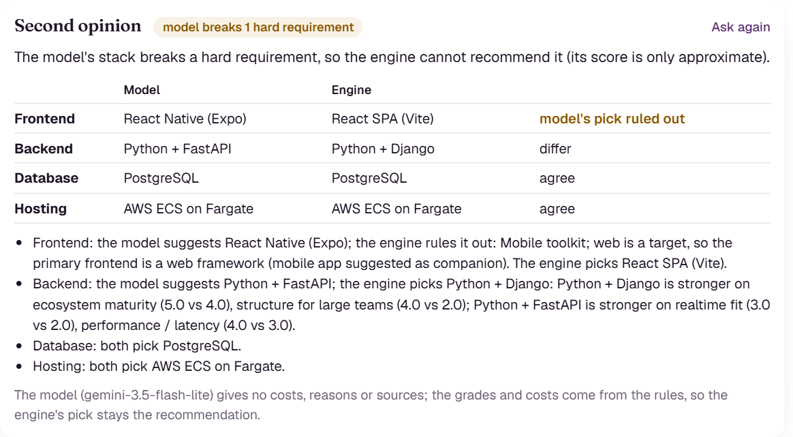

In the second opinion the model proposes a mobile toolkit for the front end, which the rules rule out because the project targets the web, and a different back end that the engine ranks below its own pick. The engine's recommendation does not change.

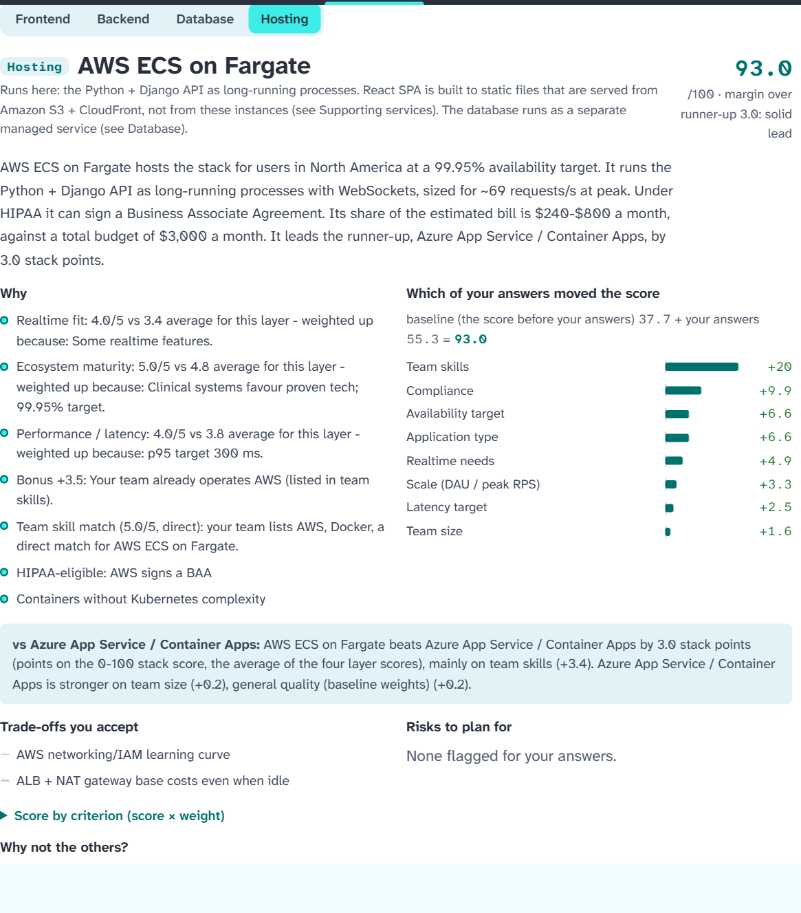

The scores themselves are judgements anchored to a published rubric (Appendix C): the rubric makes a score auditable, but it does not make it a measurement. More screenshots (alternatives, growth path, glossary, refine form, edge cases) are in Appendix F.

---

## 4. Sample recommendations

Each recommendation below can be reproduced: open the app and click the example, or run `python cli.py --preset <id>`. The full text for each of the 14 presets is in `report/samples/*.md`, Appendix A prints one in detail, and Appendix D lists all 14 in one table with five more screenshots.

### 4.1 A sample

<!-- BEGIN gallery -->

**Startup SaaS MVP.** Next.js (React) + Supabase (BaaS on Postgres) + PostgreSQL + Cloudflare Pages + Workers, about $26 a month.
Why it fits: backend, low ops burden: 5.0/5 vs 4.2 average for this layer; hosting, low ops burden: 5.0/5 vs 4.0 average for this layer.
<!-- END gallery -->

### 4.2 One answer apart

Each pair changes a single answer of a built-in example; the layers that changed are in bold, with the engine's own reason. Two more pairs are in Appendix D.

<!-- BEGIN pairs -->
**Startup SaaS MVP, then add HIPAA** (preset `startup_mvp`; changed answer: `compliance`: gdpr → gdpr, hipaa)

| Layer | Before | After |
|---|---|---|
| Frontend | Next.js (React) | Next.js (React) |
| Backend | Supabase (BaaS on Postgres) | **Node.js + Express** |
| Database | PostgreSQL | PostgreSQL |
| Hosting | Cloudflare Pages + Workers | **Google Cloud Run** |
| Est. cost / month | $26 | $22–$85 |

- Backend: Supabase (BaaS on Postgres) now takes a penalty (Minimum ~$584/month is 11.7x the whole budget), moving the gap 17.8 points toward Node.js + Express; cost at your scale moved the gap 11.1 points toward Node.js + Express (Node.js + Express 5.0/5 vs Supabase (BaaS on Postgres) 1.5/5, was 5.0 vs 4.8).
- Hosting: Cloudflare Pages + Workers is now ruled out: No HIPAA Business Associate Agreement available.
<!-- END pairs -->

---

## 5. Edge-case handling

| Situation | What StackSense does |
|---|---|
| Missing answers | Uses the documented default and lists it under "Defaults used" |
| Invalid values (negative users, text in a number field, an unknown option, a number too large for a float) | Clamps or replaces the value and shows a warning |
| Contradictions (one developer and microservices, 99.99% availability with two people, 20 ms latency across continents) | Detects 21 contradiction checks, resolves by priority (compliance > deployment > physics and team > budget and preferences) and states the resolution |
| HIPAA or PCI on a free-tier budget | Never relaxes compliance; raises a critical warning with the minimum compliant cost |
| EU and India residency together | Requires hosts with both regions; warns about split deployments |
| No option survives the filters | Relaxes preference-based constraints only (never compliance) and says which one |
| A read-only site | Recommends no database and no server code ("content files in git") and names the feature that would change that |
| User does not know an answer | "Not sure" and the Depends-on analysis (Section 2.4) |
| Model returns an unsupported value | The brief reader drops any model value that fails the schema or has no quote in the text, so it never reaches the form |
| No API key, or the model is down | The pattern reader and the template summary are used, and the badge says "template fallback" |

The engine can raise 50 distinct warning codes, and `tests/test_edge_cases.py` fails if any code lacks a test that triggers it. Screenshots of the contradictory example, HIPAA on a zero budget and a negative user count are in Appendix F.

---

## 6. Validation

<!-- BEGIN validation -->
| What is checked | Tests |
|---|---|
| Scoring, constraints and cost | 316 |
| Explanations match the engine | 123 |
| Inputs, edge cases and warnings | 150 |
| Stability and properties | 76 |
| Language-model layer (checks and fallbacks) | 172 |
| Accuracy against the answer key | 9 |
| App, packaging and documents | 71 |
| **All** | **917** |
<!-- END validation -->

The per-file list is `report/validation.md`.

### 6.1 Benchmark against an answer key

<!-- BEGIN bench -->
- **Benchmark against an answer key** (`python tools/bench.py`, `tests/test_benchmark.py`): 40 project briefs, each with a best pick and an acceptable set per layer, from an answer key written before measurement, with sources. The labels were written by a language model playing three architect personas (a startup CTO, an enterprise architect, a cloud engineer), blind to the engine, not by human raters. A pick counts as acceptable if at least 2 of 3 personas accept it. The personas agree on the best pick 92% of the time (Krippendorff alpha 0.91, a measure of agreement between the personas, not between human raters). 10 briefs were held out and never used for tuning.

| Layer | Tuning top-1 | Tuning acceptable | Held-out top-1 | Held-out acceptable |
|---|---|---|---|---|
| frontend | 97% (29/30) | 100% (30/30) | 80% (8/10) | 90% (9/10) |
| backend | 86% (25/29) | 93% (28/30) | 80% (8/10) | 100% (10/10) |
| database | 80% (24/30) | 97% (29/30) | 70% (7/10) | 100% (10/10) |
| hosting | 72% (21/29) | 97% (29/30) | 60% (6/10) | 90% (9/10) |
| All layers | 84% (99/118) | 97% (116/120) | 72% (29/40) | 95% (38/40) |

Before the general rule fixes made on the 30 tuning briefs, the held-out briefs scored 60% (24/40) top-1 and 80% (32/40) acceptable. The picks outside the acceptable set are listed by `python tools/bench.py --briefs`.
<!-- END bench -->

Top-1 is scored on 158 of the 160 picks, because for 2 layer picks (backend and hosting of brief A05) the personas have no majority best pick. Because a language model wrote the key, it shares its origin with the LLM-only baseline below and may reward that baseline's habits; no human architect has checked the labels.

### 6.2 LLM-only baseline

<!-- INSERT llm-baseline -->

### 6.3 Other checks

- **Random projects.** `python tools/fuzz.py` draws 10,000 seeded random projects and checks 14 properties against the knowledge-base files directly, without reusing the engine's own filters: hard constraints (HIPAA, PCI, residency, on-premises, mobile, strong consistency), byte-identical output on a repeat, no change from renaming or reordering lists, USD and INR budgets agreeing, a warning for every relaxed layer, and no crash. Result: 0 violations of 14 properties; the 14th (no layer returns to a pick it had left as users grow) is checked on 1,000 growth walks and is violated in 0 of them, down from 296 before the stability rules.
- **Question influence.** 8,159 engine re-runs (Section 2.3).
- **Stability of the picks.** `python tools/robustness_report.py` prints, for every preset, how often each pick survives score noise. The least stable pick is the `contradictory` example's database (PostgreSQL), which holds in 53% of runs with noise up to 0.25 points and 63% with noise up to 0.5, so its margin over MySQL is small.
- **Offline use.** With no key, `tests/test_no_network.py` checks that the page loads no external resource and that the API answers with outbound connections blocked. A key adds calls only to the model provider, only for the four features in section 1.1.

---

## 7. Limitations

- Scores, cost bands and compliance flags are curated from public vendor documentation as of October 2026. Prices and compliance programmes change; verify them with each vendor before committing.
- Scores are judgements anchored to a rubric, not measurements. I did not re-score the whole knowledge base against the rubric, and a different curator would give different scores.
- The benchmark labels were written by a language model in three architect personas, not by people, so the agreement figures measure fit to a model-written key. The benchmark has 40 briefs. Held-out accuracy on 10 of them is 72% top-1 and 95% acceptable, so one brief moves it by ten points.
- Growth stability is measured, not proved: 0 of 1,000 random growth walks returns to an earlier pick, but other answers can still produce a return.
- The cost model uses price bands per scale tier plus stated usage terms, not a full bill of materials. Egress, support plans and most third-party software-as-a-service are excluded.
- The knowledge base holds 60 technologies. Niche options (CockroachDB, Oracle, Rust frameworks) are not scored; an existing Oracle database is acknowledged with a warning. SQL Server, BigQuery and Neo4j are scored.
- The pattern reader understands numbers, money and common phrases, not arbitrary prose. Without a key some answers stay unfilled, and the questions below the description box still ask for them.
- The free-tier models (Google Gemini by default) have daily request limits and the app stops itself at a configurable daily cap, which is why model replies are cached on disk. The LLM-only baseline (6.2) is one model chain on one run of the 40 briefs.
- No human architect audited the presets' picks beyond the benchmark.

<!-- INSERT appendix-a -->

<!-- INSERT appendix-b -->

## Appendix C. Score rubric

Every technology score is an integer from 1 (poor) to 5 (excellent) for that criterion. Scores are curated by hand from the vendor documents listed on each technology; they are judgements anchored to the definitions below, not measurements.

| Criterion | Meaning | 1 | 3 | 5 |
|---|---|---|---|---|
| ease | How gentle the learning curve and first setup are | Weeks of study before a first working feature | A few days with the official tutorial | A working app in an afternoon from a quickstart |
| ops | How little operational work the team does (patching, scaling, backups) | The team runs servers, upgrades and backups itself | Managed service, but the team tunes capacity and configuration | Fully managed; nothing to patch or scale by hand |
| maturity | Years in production use, stability of the API, size of the ecosystem | Under 2 years old or breaking changes every release | 3 to 7 years, stable core, smaller ecosystem | 10+ years, long-term support releases, very large ecosystem |
| performance | Typical speed and resource use under load for this layer | Noticeably slower or heavier than peers in public benchmarks | Average for its category | Among the fastest in its category in public benchmarks |
| scalability | How far it grows before a redesign is needed | Single machine or tens of requests per second | Thousands of requests per second with standard tuning | Documented use at hundreds of thousands of requests per second or more |
| realtime | Support for long-lived connections and live updates | No persistent connections; polling only | Possible with an add-on service or beta feature | Built in and documented for production use |
| seo | Whether crawlers receive finished HTML | Client-side rendering only | Server rendering available but not the default or needs extra setup | Server or static rendering by default |
| velocity | How quickly a small team ships features | Much boilerplate; every feature is custom work | Good libraries for common needs, some glue code | Batteries included: auth, data access and admin come ready |
| hiring | Size of the pool of developers who already know it | Fewer than 1 in 50 developers in public surveys | About 1 in 10 developers | More than 1 in 4 developers |
| structure | Support for keeping a large codebase organised | No conventions; structure is up to each developer | Conventions exist but are optional | Opinionated structure enforced by the framework |
| interactivity | Fit for rich, stateful user interfaces | Page-at-a-time rendering only | Sprinkled interactivity with some client state | Component model built for complex client state |
| offline | Support for working without a network connection | Needs a connection at all times | Can cache data; sync is hand-written | Built-in local storage and sync |

Scores of 2 and 4 sit between the anchors. The rubric is a reading guide: the sources for each technology are in `report/sources.md`, and the rules and weights that combine the scores are in the knowledge base and `engine/scoring.py`.

## Appendix D. More sample recommendations

All 14 built-in examples, as the engine recommends them today, then the other five screenshots and two more one-answer-apart pairs.

<!-- BEGIN presets -->
The 14 built-in examples, as the engine recommends them today:

| Scenario | Frontend | Backend | Database | Hosting | Est. cost / month | Top reason for the host |
|---|---|---|---|---|---|---|
| Startup SaaS MVP | Next.js | Supabase (BaaS on Postgres) | PostgreSQL | Cloudflare Pages + Workers | $26 | Low ops burden |
| Indian e-commerce at scale | Next.js | Java/Kotlin + Spring Boot | MySQL | AWS EKS (Kubernetes) | $10,800–$57,000 | Realtime fit |
| HIPAA telehealth platform | React SPA | Python + Django | PostgreSQL | AWS ECS on Fargate | $370–$1,815 | Realtime fit |
| Realtime multiplayer game backend | React SPA | Go (net/http, chi or Gin) | MongoDB | Fly.io | $1,325–$4,800 | Realtime fit |
| IoT telemetry pipeline | React SPA | Go (net/http, chi or Gin) | TimescaleDB (Postgres) | AWS ECS on Fargate | $1,365–$7,700 | Scalability |
| On-prem internal tool | Server-rendered HTML + HTMX | Python + Django | SQLite (+ Litestream backups) | On-prem VMs + Docker Compose | $0–$150 | Learning curve |
| AI document-search product (RAG) | Next.js | Python + FastAPI | PostgreSQL | Google Cloud Run | $367–$4,575 | Low ops burden |
| Student project (zero budget) | React SPA | Firebase (BaaS on Google Cloud) | Cloud Firestore | Vercel | $0 | Cost at your scale |
| SEO content site / blog | Next.js | No server code (static site) | No database (content files in git) | Netlify | $0 | Cost at your scale |
| Mobile-first social app (India) | React Native | Firebase (BaaS on Google Cloud) | Cloud Firestore | Provided by Firebase | $683–$4,552 | Nothing of yours needs hosting |
| College fest website (India) | Next.js | Serverless functions (Node/Python FaaS) | PostgreSQL | Cloudflare Pages + Workers | $15–$55 | Cost at your scale |
| UPI payments app (India) | Native iOS + Android | Java/Kotlin + Spring Boot | PostgreSQL | AWS EKS (Kubernetes) | $3,700–$14,750 | Ecosystem maturity |
| Food delivery platform (India) | Next.js | Node.js + NestJS | PostgreSQL | AWS EKS (Kubernetes) | $24,500–$125,000 | Realtime fit |
| Edge case: contradictory inputs | Next.js | Node.js + Express | PostgreSQL | Azure App Service / Container Apps | $89,000–$330,000 (over budget) | Low ops burden |
<!-- END presets -->

<!-- BEGIN gallery_more -->
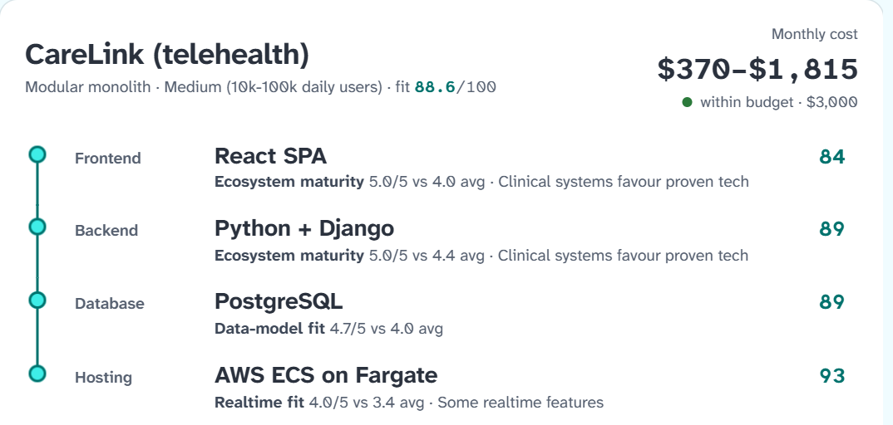

**HIPAA telehealth platform.** React SPA (Vite) + Python + Django + PostgreSQL + AWS ECS on Fargate, about $370–$1,815 a month.
Why it fits: backend, ecosystem maturity: 5.0/5 vs 4.4 average for this layer; hosting, realtime fit: 4.0/5 vs 3.4 average for this layer.

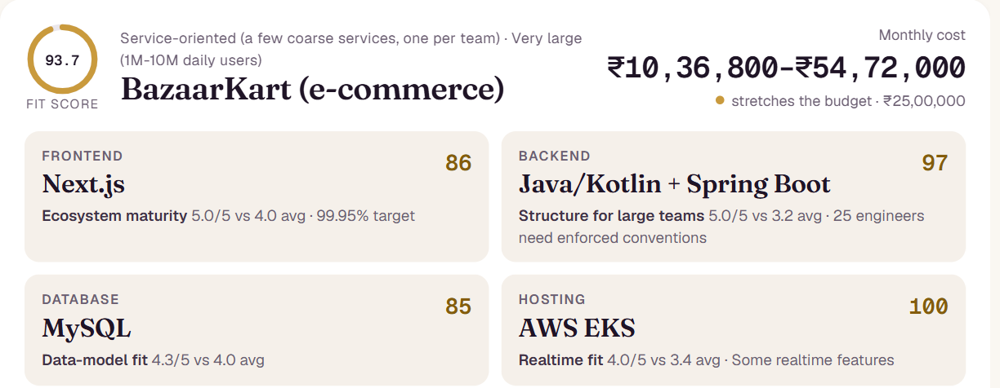

**Indian e-commerce at scale.** Next.js (React) + Java/Kotlin + Spring Boot + MySQL + AWS EKS (Kubernetes), about $10,800–$57,000 a month.
Why it fits: backend, structure for large teams: 5.0/5 vs 3.2 average for this layer; hosting, realtime fit: 4.0/5 vs 3.4 average for this layer.

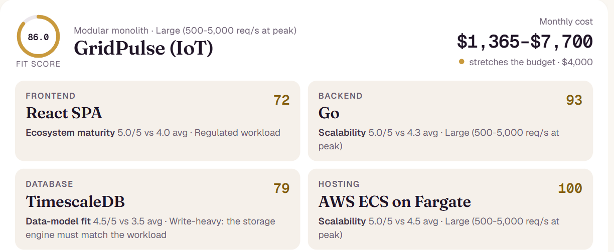

**IoT telemetry pipeline.** React SPA (Vite) + Go (net/http, chi or Gin) + TimescaleDB (Postgres) + AWS ECS on Fargate, about $1,365–$7,700 a month.
Why it fits: backend, scalability: 5.0/5 vs 4.3 average for this layer; hosting, scalability: 5.0/5 vs 4.5 average for this layer.

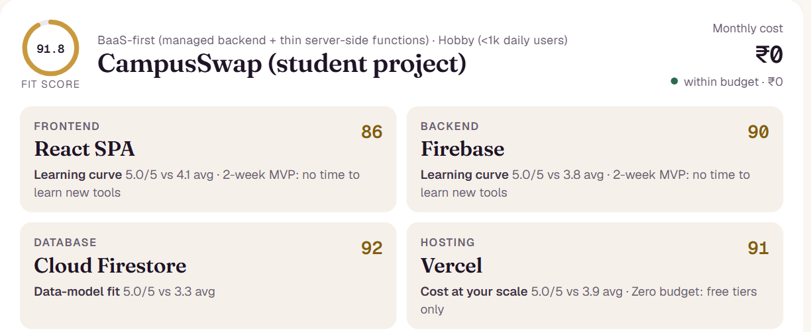

**Student project (zero budget).** React SPA (Vite) + Firebase (BaaS on Google Cloud) + Cloud Firestore + Vercel, about $0 a month.
Why it fits: backend, learning curve: 5.0/5 vs 3.8 average for this layer; hosting, cost at your scale: 5.0/5 vs 3.9 average for this layer.

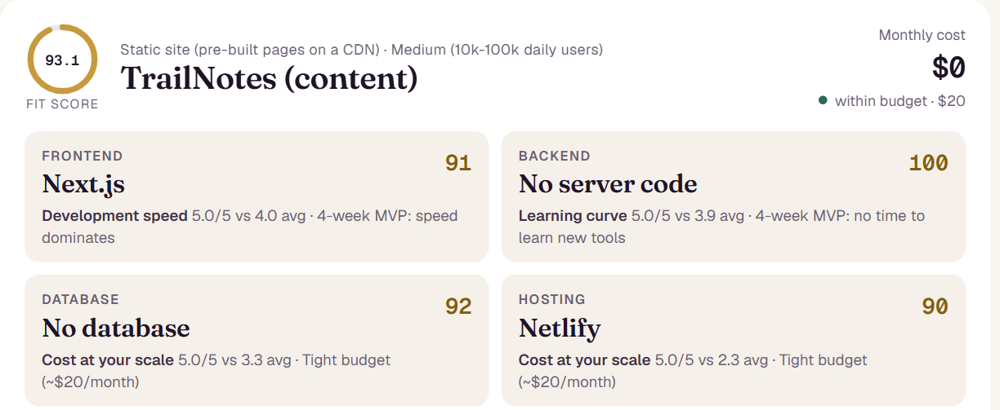

**SEO content site / blog.** Next.js (React) + No server code (static site) + No database (content files in git) + Netlify, about $0 a month.
Why it fits: backend, learning curve: 5.0/5 vs 3.9 average for this layer; hosting, cost at your scale: 5.0/5 vs 2.3 average for this layer.
<!-- END gallery_more -->

<!-- BEGIN pairs_more -->
**IoT telemetry, 40,000 devices vs 5 million** (preset `iot_telemetry`; changed answer: `dau`: 40,000 → 5,000,000)

| Layer | Before | After |
|---|---|---|
| Frontend | React SPA (Vite) | React SPA (Vite) |
| Backend | Go (net/http, chi or Gin) | Go (net/http, chi or Gin) |
| Database | TimescaleDB (Postgres) | TimescaleDB (Postgres) |
| Hosting | AWS ECS on Fargate | AWS ECS on Fargate |
| Est. cost / month | $1,365–$7,700 | $38,500–$140,000 |

**Internal tool, own servers vs cloud** (preset `internal_tool`; changed answer: `deployment`: on_prem → cloud)

| Layer | Before | After |
|---|---|---|
| Frontend | Server-rendered HTML + HTMX | Server-rendered HTML + HTMX |
| Backend | Python + Django | Python + Django |
| Database | SQLite (+ Litestream backups) | SQLite (+ Litestream backups) |
| Hosting | On-prem VMs + Docker Compose | **Render** |
| Est. cost / month | $0–$150 | $7 |

- Hosting: On-prem VMs + Docker Compose is now ruled out: On-premises option; you chose public cloud.
<!-- END pairs_more -->

## Appendix E. Input research in detail

**Coverage of the quality-attribute frameworks.** Each row is a quality attribute, the matching ISO/IEC 25010:2023 characteristic and Well-Architected pillar, the questions that capture it, and the criteria or hard filters that score it. The 2023 edition renamed Usability to Interaction capability and Portability to Flexibility, and added Safety.

| Quality attribute | ISO/IEC 25010 | Well-Architected pillar | Questions that capture it | Criteria scored or hard filters |
|---|---|---|---|---|
| Performance | Performance efficiency | Performance efficiency | daily users, peak requests per second, users online at the same moment, traffic pattern, cacheable share, latency target, read/write mix | performance, scalability, scale ceiling |
| Reliability | Reliability | Reliability | availability target, user regions, consistency | scalability, ops, cost multiplier for capacity you run yourself |
| Security and compliance | Security | Security | compliance (GDPR, DPDP, HIPAA, PCI-DSS, SOC 2, data residency), user regions, company single sign-on (SSO) | compliance maturity, region coverage, BAA, PCI and region filters |
| Cost | (none) | Cost optimisation | monthly budget, currency, top-3 priorities | cost at your scale, budget guard |
| Operability | Maintainability | Operational excellence | team size, availability target, architecture preference | ops burden, minimum team size |
| Team fit | Maintainability | (none) | team skills, time to MVP, team size | skill match, learning curve, development speed, hiring pool, structure, maturity |
| Portability and lock-in | Flexibility | (none) | lock-in tolerance, deployment model, preferred cloud | portability, deployment filter |
| Compatibility | Compatibility | (none) | existing systems to keep, client platforms, deployment model | existing-system bonus, platform filter, compatibility rules |
| Functional fit | Functional suitability | (none) | application type, what users do, special workloads, background work, customer organisations sharing the app (tenancy), data shape, realtime, SEO, offline | data-model fit, realtime, SEO, interactivity, offline |
| User experience | Interaction capability | (none) | latency target, realtime, offline, client platforms | performance, interactivity, realtime, offline, platform filter |

Safety (new in the 2023 edition) is not scored: the four layers are infrastructure, and none of the options changes whether the product can harm people or property. Health data is covered under Security (HIPAA, data residency).

**ATAM in this engine.** The Architecture Tradeoff Analysis Method names four artefacts; each has a concrete counterpart in StackSense.

| ATAM artefact | What it is in ATAM | Where it is in StackSense |
|---|---|---|
| Utility tree | Quality attributes ranked by importance, refined into concrete requirements | The criteria weights: your top-3 priorities plus the weight each answer adds (the "Inputs & weights" tab of the result) |
| Scenarios | Concrete situations the architecture must handle, used to test it | The 14 presets (worked example projects) and the 40 benchmark briefs (section 6.1), whose answer key gives the expected stack for each |
| Sensitivity points | Decisions where a small change in one input changes the result | "Depends on": the answers marked Not sure whose plausible values flip a layer (section 2.4), and the ask-next ranking |
| Trade-off points | Decisions that help one quality attribute and hurt another | The conflict warnings (engine/conflicts.py, e.g. 99.99% availability on free tiers only, or a 30 ms target across regions) and the compatibility rules that cost points on one layer to gain on another |

Why each group of questions is asked, with its sources, is in the app (the Why we ask button) and in `data/questions.json`; Appendix B lists every question.

## Appendix F. More screenshots

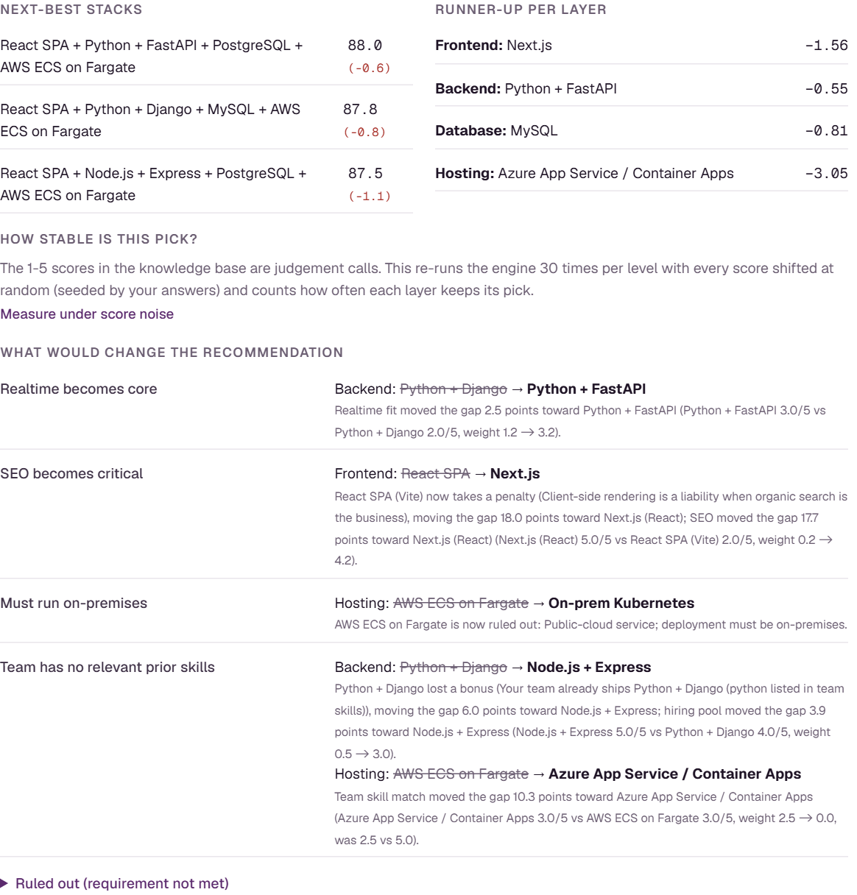

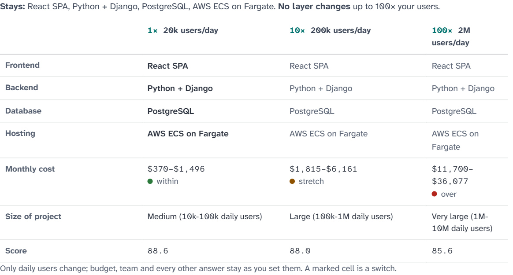

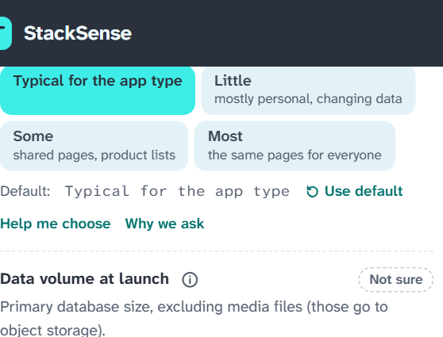

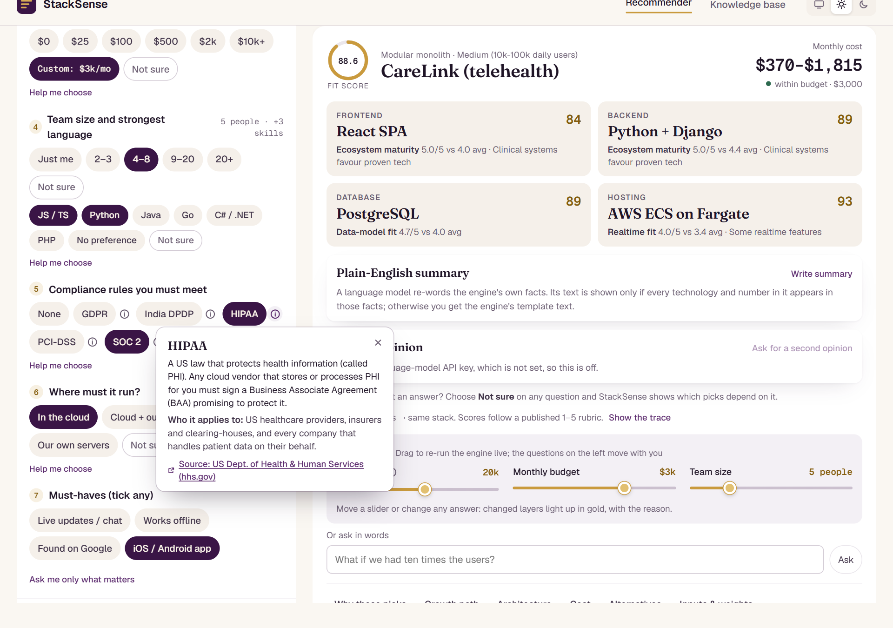

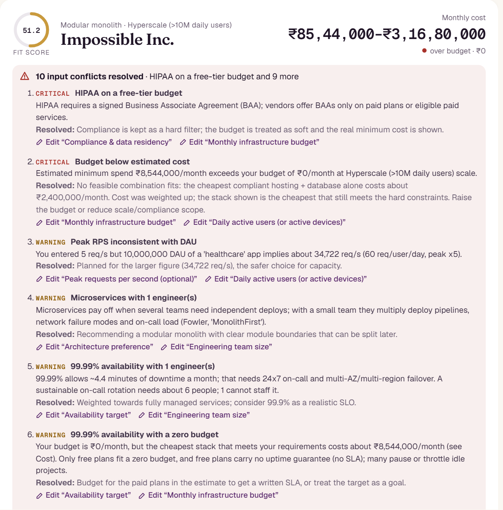

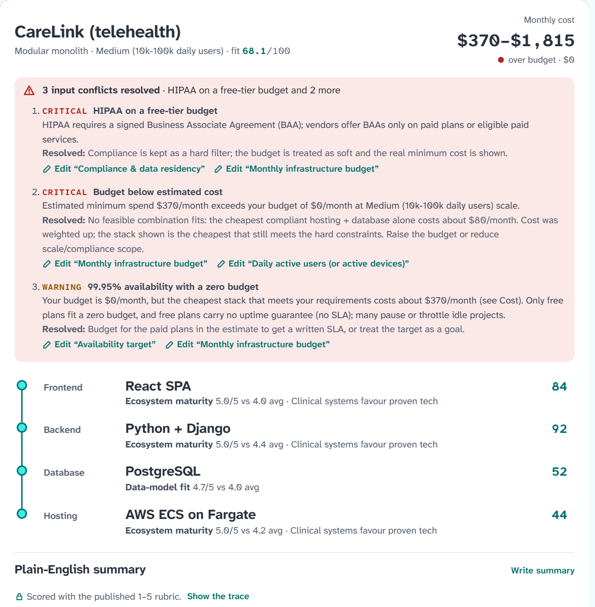

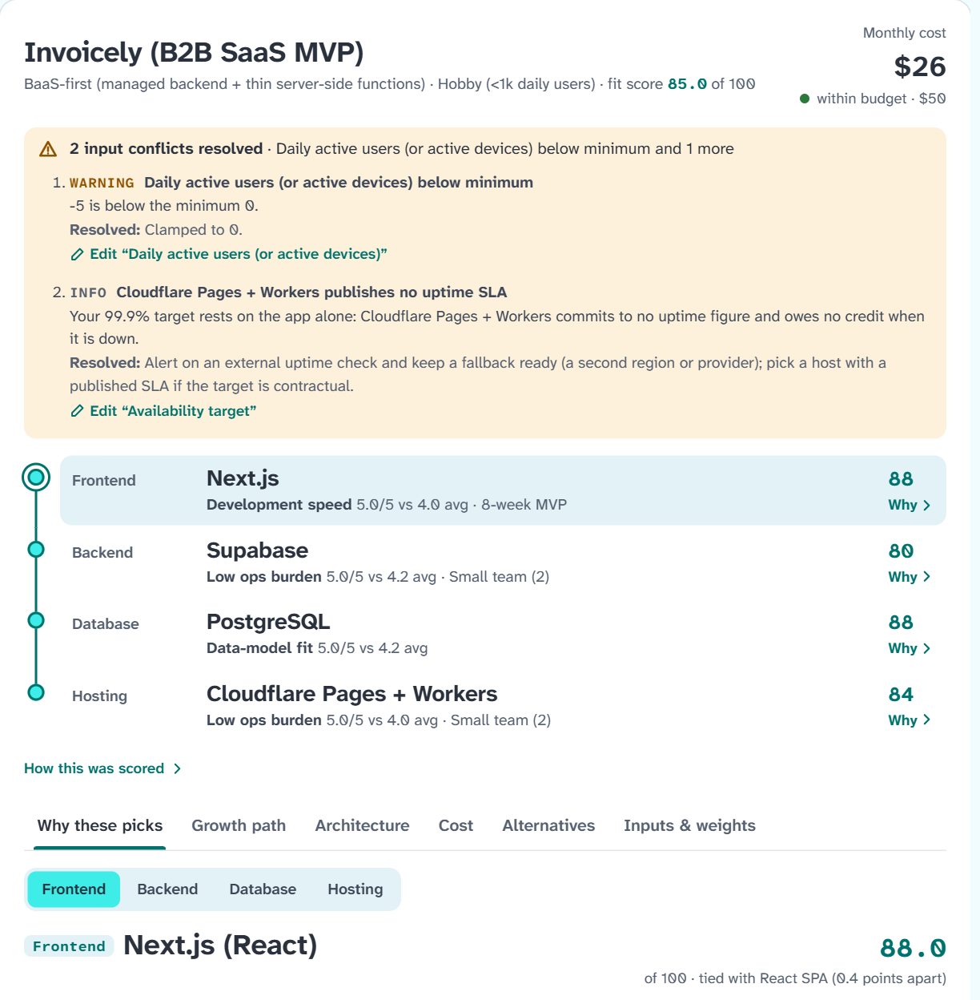

## Appendix G. Tools, licences and sources

**Libraries and licences.** Run time: [FastAPI](https://fastapi.tiangolo.com/) (MIT), [Starlette](https://starlette.dev/) (BSD-3), [Pydantic](https://docs.pydantic.dev/) (MIT) and [Uvicorn](https://uvicorn.dev/) (BSD-3); the browser code uses no third-party JavaScript. Tests and this report only: pytest (MIT), HTTPX (BSD-3), markdown-it-py (MIT), pypdf (BSD-3), Playwright for Python (Apache-2.0) and Google Chrome. Fonts bundled in `app/static/fonts/` (SIL Open Font License 1.1): Fraunces, Geist and Geist Mono. The optional language-model client (`engine/llm.py`) uses only the Python standard library and calls an OpenAI-compatible chat API, by default Google's Gemini free tier; no model is bundled. The README's Credits section lists every library, font and technique with its link.

**Datasets and sources.** StackSense ships no third-party dataset. Hiring-pool scores use the [Stack Overflow Developer Survey 2024](https://survey.stackoverflow.co/2024/technology) as a proxy, and the exchange rate is the FBIL reference rate of September 2026. Every technology, rule, question and glossary entry cites official documentation; the register of 344 URLs is in `report/sources.md`, not printed in this PDF.

**How to reproduce.** From the repository root: `python run.py` starts the app; `python -m pytest` runs the tests; `python tools/bench.py`, `python tools/fuzz.py` and `python tools/question_influence.py` rerun the benchmark, the random-project test and the question-influence study; `python tools/capture_screenshots.py` retakes the screenshots; `python tools/build_assets.py` then `python tools/build_report.py` regenerate the tables and this PDF. The README lists every command with its options.

## Appendix H. Design detail

### H.1 The seven pipeline stages

1. **Normalise.** Missing answers get documented defaults, listed as assumptions; invalid or extreme values are clamped with a warning.
2. **Derive.** Peak requests per second = daily users x requests per user for the app type / 86,400 x a peak factor x the share of traffic that reaches the servers. Scale tier (six size bands, from under 1,000 to over 10 million daily users, or under 5 to over 50,000 requests/s at peak) comes from daily users or peak load, whichever is higher, and its label names the one that set it (30,000 daily users of a realtime app at ~520 requests/s is "Large (500-5,000 req/s at peak)").
3. **Detect conflicts.** 21 cross-field checks, for example one developer asking for microservices or HIPAA on a zero budget. Each states how it was resolved, in the order *compliance > deployment model > physics and team capacity > budget and preferences*.
4. **Weight the criteria.** 19 criteria (cost at your scale, scalability, ops burden, team skill match and more). A weight is a baseline plus contributions from specific answers, each stored with the answer that caused it.
5. **Filter, then score.** Hard constraints remove options first (HIPAA agreement, PCI attestation, data residency, on-premises, strong consistency, scale ceiling); preference-based ones are relaxed only if a layer would be empty, compliance never. Score = sum(weight x score) / sum(weight), rescaled to 0 to 100.
6. **Search stacks.** The top 5 options per layer give 625 combinations, adjusted by compatibility rules (synergies such as Next.js with Vercel, caveats, conflicts such as long-lived WebSockets on Netlify). A stack point is one point on the 0 to 100 stack score, the average of the four layer scores. Stacks within 1 point of the top are tied (the tie margin: the scores are estimates, so a gap that small is not a real difference) and are resolved by fixed preferences. The engine also works out the answer at all six scale tiers, so a pick does not flip back to a technology the growth path already left.
7. **Explain.** Reasons, trade-offs, risks, the margin over the runner-up, the architecture style, supporting services, a USD and INR cost estimate against the budget, and up to 14 counterfactual re-runs.

### H.2 A knowledge-base entry

Each technology carries 1-to-5 scores for twelve criteria against a published rubric (Appendix C), cost bands in USD per month for six scale tiers, compliance flags (HIPAA Business Associate Agreement with its minimum price, PCI, SOC 2), regions, a scale ceiling, the smallest sensible team, lock-in (how hard it is to leave the vendor later) and strengths and weaknesses with sources. The scores are curated judgements from vendor documents, anchored by the rubric; they are not measurements. For example, the AWS ECS on Fargate entry carries a HIPAA BAA flag with its source, a compliance maturity of 5, and the facts that it runs long-lived processes and WebSockets; those are the facts the HIPAA sample in Appendix A quotes.

### H.3 API

The app serves JSON endpoints for the recommendation, the "Not sure" analysis, the next question to ask, why a pick changed, why-not comparisons, pick stability, Markdown and decision-record export, and the four language-model features (brief, summary, what-if, second opinion). `POST /api/recommend` takes any subset of answers and returns the full explained recommendation. Every endpoint, with its inputs and outputs, is listed in `docs/REFERENCE.md`, and interactive docs are served at `/docs`.

### H.4 How this differs from the usual sources

| Source | What it gives | What it cannot do for one project |
|---|---|---|
| [StackShare](https://stackshare.io/) | Which companies use which tools | It takes no project constraints as input, so popularity stands in for fit |
| [Thoughtworks Technology Radar](https://www.thoughtworks.com/radar) | Adopt, trial, assess or hold ratings written by practitioners | It rates technologies in general, not for a given team size, budget or compliance rule |
| [DB-Engines ranking](https://db-engines.com/en/ranking) | A monthly popularity ranking of databases | Databases only, and popularity is not suitability |
| A general-purpose chatbot | A fluent answer in seconds | The pick can differ between runs and no rule it can show excludes an option. Section 6.2 measures an LLM-only baseline on the same benchmark |

StackSense uses these sources as inputs rather than competing with them: the Stack Overflow survey is the proxy for hiring pools, and every technology cites its vendor documentation.

### H.5 Questions deliberately not asked

sustainability and carbon (no vendor publishes a comparable per-workload figure, so a score would be invented), interface design and accessibility (StackSense picks infrastructure layers), CI/CD, testing and monitoring vendors (they follow from the stack and appear as supporting services), start-up credits (they vary by programme and date, which would make costs impossible to reproduce), and tool taste ("I like Svelte"; skills are asked, taste is not).
